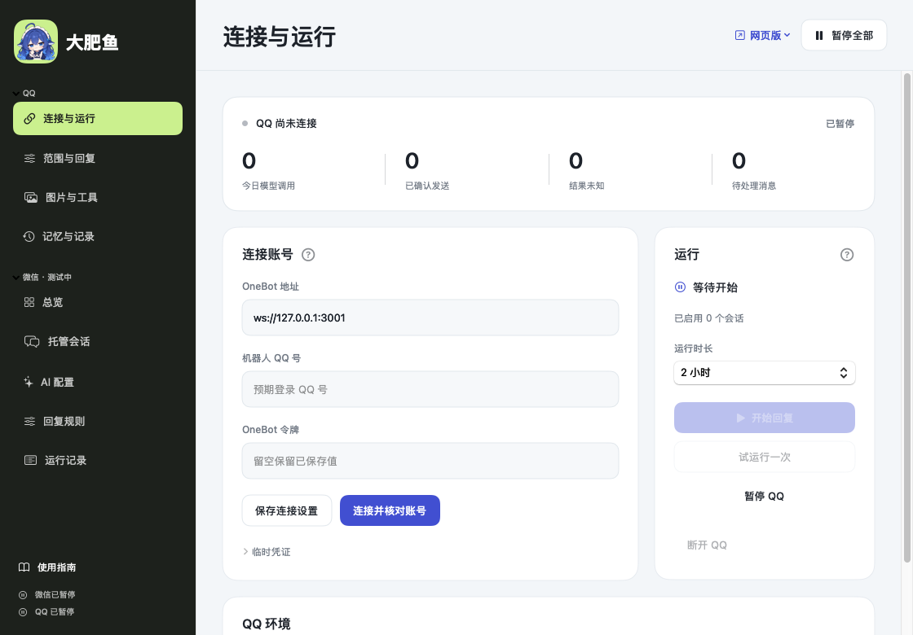
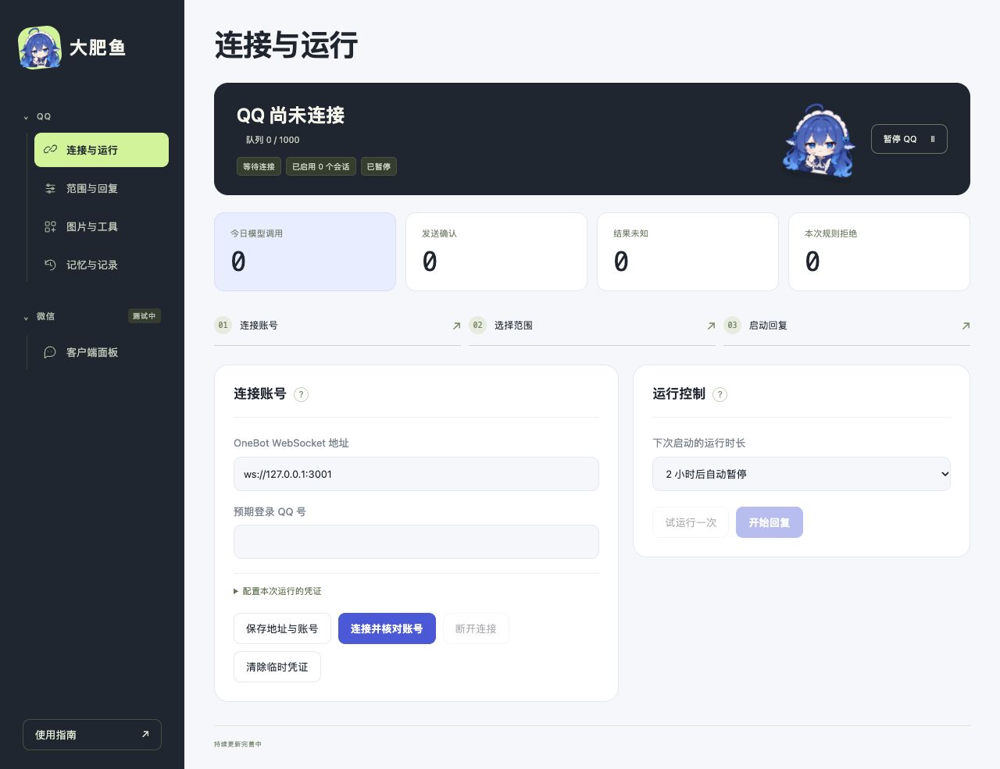
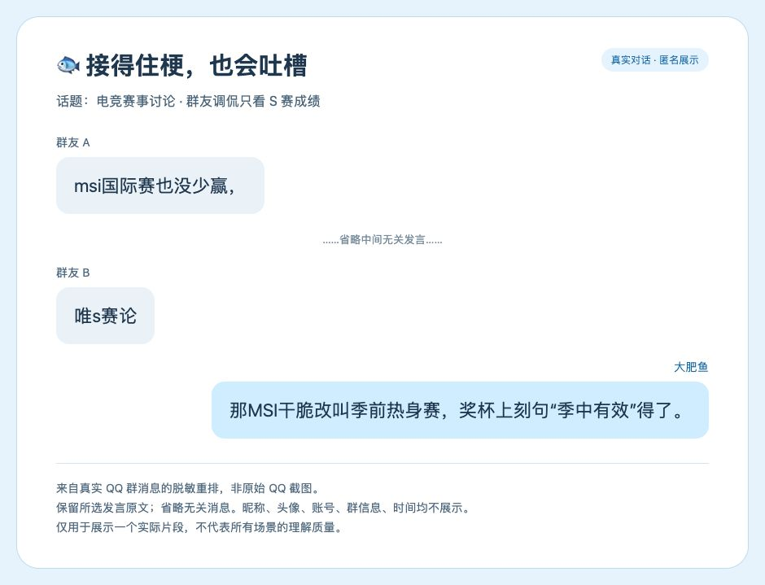

<div align="center">


# 大肥鱼 · Da Fei Yu 🐟

**养一只大肥鱼：陪你聊 QQ，也能带着自己的人设去逛小红书。**

QQ 可用 · 小红书公开测试 · 微信测试中 · macOS 原生 / Windows WSL2 本机 Web 面板

[Mac 快速开始](docs/QUICKSTART.md) · [Windows 安装](docs/WINDOWS.md) · [界面预览](#界面预览) · [在线表情库](https://photos.lifanhu.me/) · [真实案例](docs/CASES.md) · [操作指南](docs/USER_GUIDE.md) · [全部命令](docs/COMMANDS.md) · [架构与开发](docs/ARCHITECTURE.md) · [问题反馈](https://github.com/SAKURAfan1023/dafeiyu-bot/issues)

</div>

大肥鱼是一个独立、非官方的成年蓝色鲸鱼娘 AI 角色，脑袋里装着 **DeepSeek**，性格由你来养。她可以是群里的嘴欠搭子，也可以是温柔陪聊的朋友；如今还多了一扇通往小红书的门。

在 **QQ**，她用短句和表情包接话，认主人、看引用、记住各自聊过的事，也能帮你搜图、生图、分享插画。在 **小红书**，你给她一个人设和想逛的话题，她就能在绑定的账号下搜笔记、读文字和已加载评论，决定要不要加入讨论。两边各过各的日子，共用模型配置，各自保管记忆与记录。

> **项目状态：持续更新、完善与迭代中。** QQ 私聊与群真实 @ 回复已有真人接收确认，可用于个人测试和部署；不代表所有新功能、所有账号或连续运行时长均已验收。微信适配仍在测试，尚未完成可靠自动回复验收，请勿按成熟功能使用。macOS 提供原生界面，Windows 提供 WSL2 + 本机 Web 面板部署方式（Linux 自动化验证通过，Windows 实机待验收，见验证记录）；QQ 桥接可在独立 Linux 环境运行。当前没有 Windows 原生 exe 安装包。

## 近期更新 · 2026 年 10 月

[v0.2.0-beta.1 更新公告与安装说明 →](docs/releases/v0.2.0-beta.1.md)

- **大肥鱼出门了**：新增与 QQ / 微信同级的小红书板块。选好话题，她会搜帖、读帖、准备评论；你可以先审稿，也可以在明确开启后让她按规则有限参与。[认识这个小红书居民 ↓](#让她去小红书逛一会儿)
- **出门也带着性格和记性**：八种小红书人格及自定义 prompt，同一帖子里的话题可留下七天摘要。再次读到这篇时，能带上之前的背景与最近发送记录。
- **两端面板重构**：QQ / 微信分区导航，卡片式布局与统一数字控件；说明收进问号，首次使用可按面板内五步教程操作。
- **角色自己定义**：十种内置性格之外，可以填写角色名和 prompt，套用闲聊、陪伴或吐槽模板，同时调整字数与配图。先应用到草稿，再保存生效。
- **表情自己挑**：[Photos](https://photos.lifanhu.me/) 已上线 125 张 DeepSeek 娘表情，包括文字梗、搞怪与可爱图集；按台词、情绪筛选，勾选后导出资源包，再导入本机。
- **按需加载与配图**：网页首批 16 张、本机 Web 表情库首批 12 张；按语境、指定情绪或关键词设置配图。网页图库与客户端默认 37 张表情相互独立，不自动安装整站资源。

## 让她去小红书逛一会儿

**你设定她是谁，她带着这个身份去认识话题。**

可以把她想成住在你电脑里的小红书居民：有自己的表达习惯，有这场聊天的笔记，也有你给她划定的活动范围。打开小红书板块，给她一个想逛的话题，再告诉她想以什么样的性格参与。

| 给她什么 | 她怎么逛 |
| --- | --- |
| 一个性格 | 大肥鱼、温柔、雌小鬼、傲娇、元气、理性、猫娘、贴吧玩梗；也能自己写角色 prompt |
| 一点个人设定 | 在补充设定里写兴趣、说话习惯和参与偏好，让她有更具体的脾气 |
| 一个想看的话题 | 搜笔记，读正文和已加载评论，挑合适的话题准备接话；没读懂或不适合时可以跳过 |
| 一段聊过的背景 | 同帖再次阅读时补上七天内的话题摘要、你校正的背景和最近五条发送记录 |
| 一次出门的安排 | 设定主题、时长与额度；默认先交草稿，也能明确开启按规则自动回复，随时暂停 |

比如，你可以给她这样的**角色设定示例**：

> 喜欢独立游戏，讲话简短，偶尔嘴欠。看到别人认真求助就好好回答；别人说玩笑话，先接住梗，别急着上课。不懂的地方别装懂。

带着这份设定，她会结合实际读到的内容准备评论。草稿会连着原帖、回复对象和阅读摘要一起交给你；你可以改几个字再让她发，也可以让她在已确认的任务范围里自行决定是否参与。人设决定她怎么说，能不能接好梗还需要在实际使用中继续打磨。

她有自己的小红书浏览器登录、任务、额度和话题记忆。QQ 和微信里的私聊不会被拿来当她出门闲聊的谈资；没发出去的草稿，也不会记成“我刚才说过”。

**这位居民目前还在试住。** 首版能读文字和有限评论，暂时看不懂笔记里的图片、视频，也不会监听全站私信和通知。已实测登录、读帖、真实模型草稿，以及一条评论被平台接受；他人可见与后续互动尚未确认。发送结果不明时会停下来核对。

[让她第一次出门：安装与使用 →](docs/XIAOHONGSHU.md) · [看看她的控制面板 ↓](#小红书面板) · [本次更新公告 →](docs/releases/v0.2.0-beta.1.md)

## 界面预览

### macOS 客户端

左侧切换 QQ 与微信分区；在同一面板管理连接、运行时长、回复范围、图片工具与记忆。下图是 SwiftUI 实际渲染的演示界面，未连接 QQ。



### Web 面板

用浏览器管理 QQ，共享同一套引擎与配置规则；提供 Windows WSL2 的操作入口。下图取自 macOS 上的隔离本机面板，不是 Windows 实机验收截图。



[查看性格编辑、Photos 与截图说明 →](docs/SCREENSHOTS.md) · [按步骤配置面板 →](docs/USER_GUIDE.md)

### 小红书面板

她的“出门准备台”：选性格、补设定、安排话题与活动范围。原生客户端与浏览器共用这套界面；截图不含账号或帖子资料。


[小红书安装与使用 →](docs/XIAOHONGSHU.md)

## 能做什么

| 能力 | 用法 / 说明 |
| --- | --- |
| 💬 QQ 自动回复 | 指定好友 / 群白名单；群真实 @；可选每 N 条普通消息评估一次加入话题 |
| 🎭 性格与自定义 | 十种内置风格；面板可自定义名称和 prompt，每群、每好友独立选择所用风格 |
| 🧠 上下文与记忆 | 主人 / 机器人 / 好友角色分离；引用还原；按条数、长度或时间整理，按会话检索 |
| 🖼️ 图片与表情 | 图片/GIF 抽帧观察；37 张自带表情、本机批量导入；按语境、指定情绪或关键词配图，可调去重时间 |
| 🗂️ Photos 画廊 | [在线挑选表情](https://photos.lifanhu.me/)：125 张 DeepSeek 娘表情，按台词、图集、情绪筛选，勾选后导出，Web / 客户端导入；每批加载 16 张 |
| 🎨 生图与找图 | 智谱生图 + Cloudflare 备用；网页检索、网络图片；可选 Google Cloud Vision 查图来源 |
| 🧭 插画命令 | `/search` 统一关键词/ID搜图并自动保底、`/hot` 日榜、`/next` 续图；命令不调用大模型 |
| ⏰ 定时分享 | 每日或每小时一张，附作者、来源和继续命令，沿用会话范围、额度和去重 |
| 🛠️ 控制面板 | SwiftUI / 本机 Web；QQ、微信分区目录，内置五步教程，问号悬停说明；连接、运行、范围、记忆与工具配置 |
| 🚶 小红书独立角色 | 带着人设逛话题、读帖、写评论，按帖记住聊天背景；可审稿或开启有限自动参与，独立登录与额度；当前阅读范围见上文 |

大肥鱼的短句不是“每秒生成一句”：默认正文上限 60 字，回复通常包含草稿和语义校对两次模型调用。思考、识图、记忆整理和联网都会影响延迟与费用，可按需要关闭。

图片发送记录保留一周；项目日志和备份已有清理规则。NapCat 4.18.41 的外部插件限制使 QQ 聊天数据库清理暂不可用；官方缓存插件的七天预览已实测，详见 [存储与清理规则](docs/STORAGE.md)。清理任务不调用大模型，保留登录配置和长期记忆。

## 看真实对话案例

**[打开案例专页 → 6 组真实私聊 / 群聊长图](docs/CASES.md)**：连续接话、性格命令、群 @ 与引用 GIF、生图回复、不确定性表达，以及一次识图失败。共 29 条消息、14 条已核对发送记录的机器人回复。图片来自真实附件；昵称与头像匿名化，聊天界面为重新排版，**非原始 QQ 截图**。

下面是早期电竞话题的简短片段；更多连续对话见案例专页。



来自实际 QQ 群的匿名片段，**脱敏重排，非原始 QQ 截图**。保留选中文本，省略无关发言；[取材方法与证据边界](docs/CHAT_EXAMPLE.md)。

## 五步开始

**Windows 用户先看 [Windows 完整安装教程](docs/WINDOWS.md)**；以下命令用于 Mac。

1. 准备 **macOS 14+、Swift 6 工具链、Python 3**，以及你自己的 **DeepSeek API Key**。
2. 按 [快速开始](docs/QUICKSTART.md) 准备 NapCat / QQ，开启带 Token 的 OneBot 11 正向 WebSocket，并完成扫码。
3. 克隆、测试并构建：

   ```sh
   git clone https://github.com/SAKURAfan1023/dafeiyu-bot.git
   cd dafeiyu-bot
   bash scripts/test.sh
   bash scripts/build.sh
   ```

4. 启动本机面板，打开终端输出的完整本机地址：

   ```sh
   'dist/WeChat AI Bot.app/Contents/MacOS/WeChatAIBot' --qq-control-panel
   ```

5. 填入你的机器人 QQ、OneBot Token、DeepSeek Key，连接后只启用明确允许的会话，先用“单次验收”。**连接成功不等于已经开始自动回复。**

密钥在本机面板配置；可使用钥匙串或仅本次运行凭证。仓库不提供任何可直接使用的账号、API Key、Token、登录二维码或原始私聊记录；案例页仅展示经作者筛选、匿名化的片段。**浏览器关闭不会停止后台**，结束时先点击暂停，终端前台运行可按 Ctrl+C 退出。

## 常用命令

```text
/persona list           查看内置与自定义性格
/persona 猫娘          切换当前会话
/persona 贴吧          切换贴吧吐槽风格
/persona default        恢复面板默认

/search 初音未来       关键词搜索，优先高收藏，无结果时保底
/hot                    从日榜前列按序获取
/search 53325959         作品 ID 直查，也支持 Pixiv 作品链接
/next                   沿用上次来源继续
/search help            查看完整帮助
```

命令仅对已启用会话生效，群内命令无需 @；群成员共享当前群性格。命令回执占发送额度，但不消耗模型调用、不计入普通群接话计数。编号仅用于菜单浏览，切换请使用名称。详细语法见 [命令表](docs/COMMANDS.md)。

## 认识大肥鱼

<div align="center">


</div>

以上为原创 AI 生成的项目示意素材，不是官方 DeepSeek 形象、真实聊天截图或第三方画师作品。大肥鱼可以俏皮、猫系、抽象或犀利；表达风格不应覆盖事实、主人识别与认真求助。公开版另附 33 张蓝发鲸鱼娘 Q 版社区图，逐张保留许可与来源，不打包许可未确认的私人收藏，详见 [素材与许可](THIRD_PARTY_NOTICES.md)。

打开 [Photos 表情库](https://photos.lifanhu.me/)，挑选喜欢的图片并导出资源包，再在面板「范围与回复 → 导入本机表情」中导入。表情触发条件、来源许可及构建发布见 [表情库与画廊使用说明](docs/PHOTO_GALLERY.md)。Web 和原生客户端共用发送规则；命中关键词只允许在当前合法回复中配图，不绕过白名单或主动发出消息。

## 状态、成本与已知边界

- **QQ 可用，持续迭代：** 已有基础私聊和群 @ 真实接收证据；其他功能需按自己的账号、模型、网络和素材再次验收。
- **微信测试中：** 原生窗口读取与控制仍属实验实现，群 @ 可靠关联和自动发送验收未完成。
- NapCat 是第三方 QQ 桥接，不是腾讯官方机器人接口；不能保证账号不会遇到风控，先用可接受风险的测试账号和小范围会话。
- DeepSeek Key 与聊天产品订阅不同；外部提供方可能计费或调整免费额度。仓库不承诺永久免费 API。
- 生图拒绝审核时不会通过换提示词或备用通道绕过；搜图只处理公开可访问作品，保留署名和来源。
- 每条命令不调用模型，不等于没有网络访问或发送额度消耗。图片、记忆和自动接话仍需按说明配置。

[安装排障](docs/QUICKSTART.md#排障) · [数据与安全](SECURITY.md) · [测试和证据边界](docs/VALIDATION.md)

## 反馈与参与

欢迎提交 [Bug Issue](https://github.com/SAKURAfan1023/dafeiyu-bot/issues/new?template=bug_report.yml)、功能建议和 Pull Request。反馈时提供版本、系统、复现步骤及脱敏错误；**不要上传密钥、完整控制地址、真实聊天、二维码或账号配置**。

有 Bug、使用问题或建议，可联系作者 **QQ：2807307652**，请备注“大肥鱼 / GitHub”。该号码仅为作者公开联系方式，不是默认机器人账号，也不会被加入运行白名单。安全问题请先私下联系，见 [SECURITY.md](SECURITY.md)。

**禁止恶意转载与滥用。** 转载或再分发请保留版权与许可声明，注明原仓库和修改内容；不得冒充作者/官方、夹带恶意代码、盗取密钥或泄露聊天及个人资料。本声明表达反滥用立场，不额外撤销 MIT 授予的合法转载、修改或商用权利。

代码使用 [MIT License](LICENSE)；原创示例图采用 [CC0 1.0](https://creativecommons.org/publicdomain/zero/1.0/)，第三方平台与工具遵循各自条款。见 [贡献指南](CONTRIBUTING.md)。

## 关键词 / Topics

中文：大肥鱼、DeepSeek、QQ机器人、QQ群机器人、小红书、社交Agent、AI聊天、二次元、鲸鱼娘、猫娘、角色扮演、性格切换、自动回复、NapCat、OneBot、会话记忆、长期记忆、上下文压缩、引用回复、表情包、GIF识别、图片理解、AI生图、搜图、Pixiv、画师、热门榜单、定时推送、Windows、WSL2、Linux、macOS、SwiftUI、本地面板、微信测试。

English: DeepSeek, QQ bot, Xiaohongshu, social agent, AI chatbot, anime companion, virtual character, roleplay, persona, NapCat, OneBot 11, conversation memory, context summarization, multimodal, GIF vision, image generation, image search, Pixiv, scheduled messages, Windows, WSL2, Linux, macOS, Swift, SwiftUI, local control panel, experimental WeChat integration.
