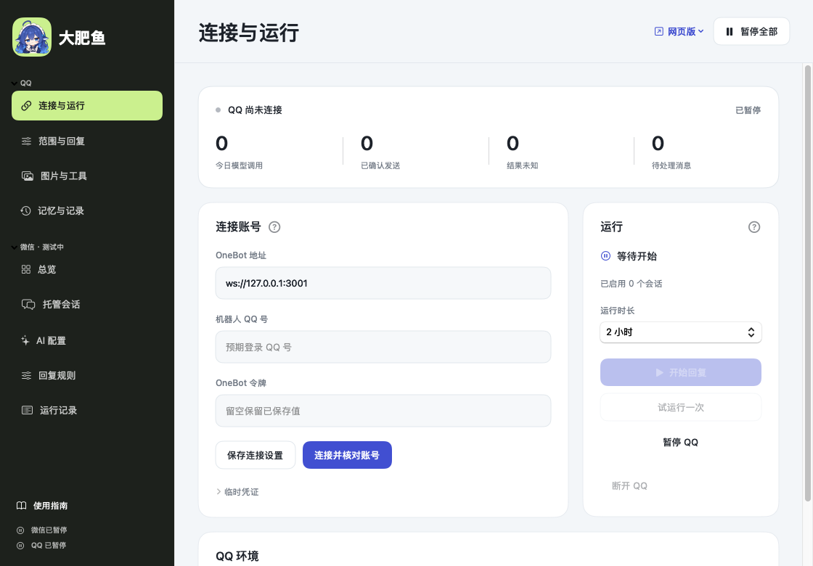

# 大肥鱼 · DaFeiYu 🐟

给 QQ 配一个有性格、有记忆的 AI 伙伴。支持 Windows 本机客户端、Mac 原生客户端，以及 MCP 工具接入。

[快速上手](#快速上手) · [npm 使用](#npm-快速使用) · [MCP 接入](#mcp-接入) · [下载页](https://github.com/SAKURAfan1023/dafeiyu-bot/releases/tag/v0.3.0-preview.3) · [界面预览](docs/SCREENSHOTS.md) · [问题反馈](https://github.com/SAKURAfan1023/dafeiyu-bot/issues)

另有独立的[五款可动少女与 Avatar MCP](docs/AVATAR_MODELS.md)，提供角色切换、表情、头部与肩肘腕细调，以及可选的本地流式少女声、口型同步和组合表演。独立使用：`npx --yes @sakurafan1023/avatar@0.2.0 preview`；[安装与语音配置](packages/avatar/README.md)。

## 快速上手

首次使用推荐完整客户端：**包内已带完整 NapCat**，QQ 安装包在同一发布页单独提供。NapCat 负责把 QQ 连接给大肥鱼；两者都准备好后，才能收发消息。

### 1. 按系统下载并安装

| 系统 | 大肥鱼客户端，已含 NapCat | 单独的 QQ 原始安装包 |
| --- | --- | --- |
| Windows 10/11 x64 | [下载大肥鱼安装程序](https://github.com/SAKURAfan1023/dafeiyu-bot/releases/download/v0.3.0-preview.3/DaFeiYu-0.3.0-preview.3-windows-x64-setup.exe) | [下载固定版本 QQ 9.9.33](https://github.com/SAKURAfan1023/dafeiyu-bot/releases/download/v0.3.0-preview.3/QQ_9.9.33_260813_x64_01.exe) |
| Mac Apple Silicon，macOS 14+ | [下载大肥鱼 DMG](https://github.com/SAKURAfan1023/dafeiyu-bot/releases/download/v0.3.0-preview.3/DaFeiYu-0.3.0-preview.3-macos-arm64.dmg) | [下载固定版本 QQ 7.0.0](https://github.com/SAKURAfan1023/dafeiyu-bot/releases/download/v0.3.0-preview.3/QQ_7.0.0_260812_01.dmg) |

先安装 QQ，再安装大肥鱼。Mac 将 QQ 放到 `/Applications/QQ.app`，将 `DaFeiYu.app` 拖入“应用程序”。已有符合版本要求的 QQ 可继续使用。

完整客户端自带 Node、QQ 后台和 MCP 模块，不需要 npm、Swift、WSL 或虚拟机。Windows 另需 [Microsoft Visual C++ x64 运行库](https://learn.microsoft.com/cpp/windows/latest-supported-vc-redist)。这些是尚未取得开发者证书的预览包，首次打开可能出现系统提示，处理方式见[安装说明](docs/DESKTOP_INSTALL.md)。

### 2. 打开内置 NapCat，登录 QQ

- Windows：从开始菜单选择“打开内置 NapCat”，或双击便携目录中的 `Open NapCat.cmd`。打开的目录里，双击 `launcher-user.bat`；Windows 10 可用 `launcher-win10-user.bat`。按控制台提示扫码，并打开它提供的 NapCat WebUI 地址。
- Mac：打开大肥鱼，在菜单栏的大肥鱼菜单中选择“打开内置 NapCat”。程序会从包内准备 NapCat 并打开配置工具；选择“切换程序入口「NapCat」”，按系统提示授权，再点“启动 NapCat”。**不必点击下载或更新 NapCat**。如果系统要求访问 QQ 数据或 App 管理权限，请按提示授权。

已有 NapCat 配置会保留。准备过程不替你登录账号，也不会开始自动回复。

### 3. 接通大肥鱼并试一次回复

在 NapCat WebUI 的网络配置里新增 **WebSocket Server（正向 WebSocket 服务）**：

| 设置 | 填写内容 |
| --- | --- |
| 监听地址与端口 | `127.0.0.1`、`3001` |
| 消息格式 | `Array` / 数组 |
| Token | 自己设置一枚随机强令牌 |
| 自身消息上报 | 开启 `reportSelfMessage` |

回到大肥鱼的“连接与运行”：

1. 填入 `ws://127.0.0.1:3001` 和扫码登录的机器人 QQ 号，保存。
2. 填入上面的 OneBot Token，以及自己的模型 API Key，点击“连接并核对账号”。OneBot Token 与 NapCat WebUI 登录密码是两回事。
3. 选择允许回复的好友或群，保存范围，点击“单次验收”。让好友发一句话，或在群内真正 @ 机器人。
4. 确认收到回复后，再调整额度和运行时长，开始持续运行。

连接成功不会自动开始回复。首次先接通文字；识图、生图、搜图等可选能力之后再配置，见[操作指南](docs/USER_GUIDE.md)。

## npm 快速使用

偏好终端时，需要 Node.js 22+ 和 npm。QQ 与 NapCat 按上面的流程准备好后，运行：

```sh
npx --yes @sakurafan1023/cli@0.3.0-preview.2 setup qq
npx --yes @sakurafan1023/cli@0.3.0-preview.2 qq panel
```

第一条安装 QQ 模块并自动选择本机后台；第二条打开客户端面板。npm 路线与完整客户端共享账号配置和后台，可按自己的习惯选择。请使用完整包名，`npx dafeiyu` 属于另一个项目。

常用后台命令：

```sh
npx --yes @sakurafan1023/cli@0.3.0-preview.2 qq status
npx --yes @sakurafan1023/cli@0.3.0-preview.2 qq pause
npx --yes @sakurafan1023/cli@0.3.0-preview.2 qq disconnect
npx --yes @sakurafan1023/cli@0.3.0-preview.2 qq stop
```

关闭浏览器或 MCP Host 不会退出独立后台。结束时先暂停、断开，再停止；完整客户端的操作见[安装与停止](docs/DESKTOP_INSTALL.md)。

## MCP 接入

MCP 用于让 Codex 等 AI 客户端调用已安装的 QQ 能力。先完成上面的 npm 安装，再注册：

```sh
codex mcp add dafeiyu -- npx --yes @sakurafan1023/mcp@0.3.0-preview.2 --modules qq
```

使用完整客户端时，也可以直接连接包内 MCP，无需另装 Node，配置示例见[客户端安装说明](docs/DESKTOP_INSTALL.md#npm-与-mcp)。

MCP 提供状态、联系人、连接设置、回复范围、运行控制、工具配置和记忆等 7 个工具。接入不会自动登录 QQ 或开始回复；凭证在本机面板填写，启动回复需要明确指令。

## 下载区怎么选

| 你的用途 | 选择 |
| --- | --- |
| 第一次使用 Windows | 大肥鱼 `setup.exe` + 同页 QQ 安装程序 |
| 第一次使用 Mac | 大肥鱼 `.dmg` + 同页 QQ `.dmg` |
| Windows 想解压即用 | [大肥鱼便携 ZIP](https://github.com/SAKURAfan1023/dafeiyu-bot/releases/download/v0.3.0-preview.3/DaFeiYu-0.3.0-preview.3-windows-x64-portable.zip)，QQ 另装 |
| 使用 npm / MCP | 上面的命令；不必手动选原生后台包 |
| 修改项目源码 | 仓库源码及[开发说明](docs/ARCHITECTURE.md) |

发布页的 `.tgz` 是 npm 模块归档，Source code 是源码；普通用户按上表选客户端即可。校验文件、固定版本和构建来源见[发布记录](docs/NPM_RELEASE.md)。

## 更多文档

| 内容 | 文档 |
| --- | --- |
| 安装、内置 NapCat、停止、卸载、包内 MCP | [客户端安装指南](docs/DESKTOP_INSTALL.md) |
| Windows 及保留的 WSL 路线 | [Windows 指南](docs/WINDOWS.md) |
| Mac 源码与既有 Linux 桥接方式 | [Mac 开发与部署](docs/QUICKSTART.md) |
| 回复规则、图片和模型配置 | [操作指南](docs/USER_GUIDE.md) |
| QQ 聊天命令 | [命令表](docs/COMMANDS.md) |
| npm 模块与后台生命周期 | [QQ 模块说明](docs/QQ_MODULES.md) |
| 测试与已知边界 | [验证记录](docs/VALIDATION.md) |
| 数据和凭证 | [安全说明](SECURITY.md) |

## 主要功能

- **QQ 聊天**：私聊与群 @ 回复，按会话设置回复范围、额度和工作时段。
- **人格与记忆**：预设或自定义性格，保留会话上下文和长期记忆。
- **图片与表情**：表情库、识图、生图、搜图与定时分享，按需启用。
- **客户端与 MCP**：Windows / Mac 客户端与 MCP 共用后台和配置，完整客户端内置 NapCat。

聊天 npm 模块当前提供 QQ；Avatar 是另行安装的独立模块。小红书 / B站为 Mac 端测试模块，微信仍在测试，见[社交平台说明](docs/SOCIAL_PLATFORMS.md)。真实 Windows QQ 扫码和收发仍需用户环境验收。

[查看界面](docs/SCREENSHOTS.md) · [真实对话案例](docs/CASES.md) · [在线表情库](https://photos.lifanhu.me/)

<details>
<summary>客户端预览</summary>



预览图为本机合成数据界面，不代表真实 QQ、Windows 或社交平台验收。

</details>

## 反馈与许可

遇到问题请提交 [Issue](https://github.com/SAKURAfan1023/dafeiyu-bot/issues/new?template=bug_report.yml)，附版本、系统、复现步骤和脱敏错误。不要上传密钥、完整控制地址、二维码、真实聊天或记忆。作者公开联系 QQ：**2807307652**，请备注“大肥鱼 / GitHub”。

项目代码采用 [MIT](LICENSE)。内置 NapCat 遵循其原始[有限再分发许可](docs/licenses/napcat/NapCat-LICENSE.txt)，含非商业用途限制；QQ 原始安装文件的版权和许可归腾讯。完整来源与第三方许可见 [THIRD_PARTY_NOTICES.md](THIRD_PARTY_NOTICES.md)。
