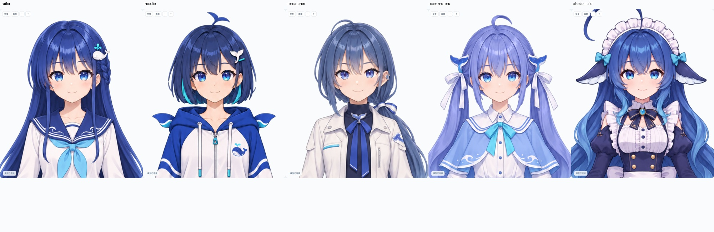
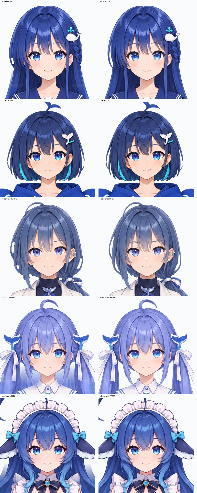
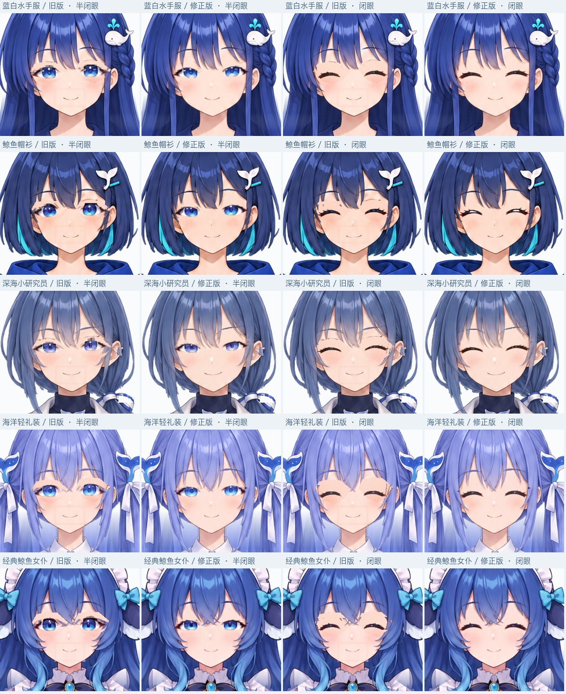

# 五款可动少女与 Avatar MCP

本机独立模块 `packages/avatar`，保留已认可的五个造型，使用 LivLiv Player 实际 WebGL2 渲染及本项目肩、肘、腕网格扩展。该模块不依赖 QQ 后台，也不启动聊天、摄像头或麦克风。独立包版本为 `@sakurafan1023/avatar@0.2.0`，安装与本地语音配置见 [包 README](../packages/avatar/README.md)。



| model_id | 形象 | 造型与活动准备 | 素材许可 |
| --- | --- | --- | --- |
| `sailor` | 蓝白水手服 | 深蓝长发、鲸鱼发夹；后发与双臂分开 | MIT |
| `hoodie` | 鲸鱼帽衫 | 保留短波波头与青色内层；宽袖和小手独立绑定 | MIT |
| `researcher` | 深海小研究员 | 白夹克、低侧马尾；马尾后层与夹克分开 | MIT |
| `ocean-dress` | 海洋轻礼装 | 浅蓝长发、浪花裙；裸臂与裙边、发束分开 | MIT |
| `classic-maid` | 经典鲸鱼女仆 | 渐变波浪长发、鲸鳍耳、环形呆毛、大鲸尾、长裙 | CC BY-NC-SA 4.0 |

经典款原角色为上善无形，女仆设计为 ZipZipPipe，本项目进行了 AI 重绘与活动绑定；代码 MIT 与该款素材许可分开。作者链与核查记录见 [素材说明](../packages/avatar/THIRD_PARTY_NOTICES.md) 和 [经典参考记录](design/deepseek-concepts-20261106/CLASSIC-REFERENCE.md)。

## 预览和 MCP

仓库根目录安装依赖后，执行：

```sh
npm run preview:avatar
```

打开终端给出的本机地址，等待“模型已连接”。默认面部与上半身近景，手臂自然下垂，进入或切换角色不会自动举手；“全身”按钮可检查完整模型。五个形象按钮可切换实际模型，表情与动作按钮直接调用同一个控制器。“方向与关节细调”默认收起，可组合注视、头部、身体和双臂输入，设置进入、停留、回位时间。一个进程同时只有一个预览窗口拥有渲染器；第二页须关闭原页后重新连接。

MCP 使用独立 stdio 入口：

```json
{"mcpServers":{"dafeiyu-avatar":{"command":"node","args":["<absolute-installation-path>/bin/avatar.mjs"]}}}
```

源码开发时入口为 `packages/avatar/bin/avatar.mjs`；安装压缩包后入口位于该 npm 包的 `bin/`。标准输出仅用于 MCP，预览地址打印到标准错误，也由 `avatar_status` 返回。调用方先 `avatar_list`，再 `avatar_select`，等 `renderer_ready=true` 后运行 `avatar_pose` / `avatar_action`。

```json
{"head":{"yaw":0.35,"pitch":0.1},"eyes":{"gaze_x":0.4,"gaze_y":-0.15},"body":{"lean":0.12},"arms":{"left":{"shoulder":0.3,"elbow":0.4,"wrist":0.15}},"expression":"raised_brow","intensity":0.7,"transition_seconds":0.6,"hold_seconds":2,"return_seconds":0.8}
```

方向和关节输入为 [-1,1]，眼睑闭合、嘴部开合、表情强度为 [0,1]。左右按画面方向命名。关节标称上限为肩 30°、肘 45°、腕 18°；头部参数交给 LivLiv 的角色体积与绑定比例求值，适合正脸附近的小角度活动，不能当作大幅侧面转头。省略的字段继续自然状态；明确填写的眼睑、眉口字段覆盖对应表情预设。

动作包含点头、摇头、侧头倾听、轻跃、含蓄低头、自然环视、左右手招呼；十种表情为自然、开心、关切、惊讶、好奇、害羞、大笑、思考、困倦、尴尬，按日常、情绪、交流分组。`expression_profiles` 提供用途及推荐节奏，显式方向与五官输入仍可覆盖对应预设。肩和肘使用连续袖子/手臂网格及平滑权重，手掌随腕关节活动；手指未逐指绑定，不能握拳、比心或翻转手心。

互不冲突的参数可并行，默认拒绝冲突，可显式使用 `on_conflict="replace"` 替换对应轨道。返回 `accepted` 表示已接受，须从 `avatar_status.recent` 查看 `completed` 和 `inputs_reset=true`。`avatar_stop` 停止并请求复位，可指定 `action_id`。`call_id` 防止重试重复播放，`expected_model` 防止向已切换的形象发送过期动作。断线中的动作记为 `uncertain`，不会在重连后自动重放。

## 流式语音与组合工具

0.2.0 增加 `avatar_say`、`avatar_perform`，保留原六项工具，共八项。语音采用显式配置的本地 Qwen3-TTS VoiceDesign MLX 6bit，默认清甜少女描述；没有模型时仍可使用全部视觉工具。模型及 Python 环境须按 [包 README](../packages/avatar/README.md#本地少女声) 安装，本包不自动下载，也不使用云端回退。浏览器须点击“开启声音”；每个新页面独立授权。

实际链路为 MCP → AvatarRuntime 资源检查 → 自有本机 Qwen 子进程 → 有序、定长校验的 24 kHz PCM → WebSocket → SpeechPlayer。口型和元音使用实际听到声音的时钟；头部、注视、眉眼及手臂继续各自的控制。静态表情嘴型让位于发声，显式手动嘴型与发声冲突。正常结束保留预热模型，取消生成仅终止本进程拥有的语音子进程，下一次明确请求重新预热。

`avatar_perform` 接受一句 speech 和一个 visual 或 action；先验证全部输入、素材、语音配置、浏览器声音授权及资源，再替换或启动，避免失败请求先中断旧动作。默认从声音实际开始时起动作；visual 保持到播完再回位，action 按自然时长结束。状态包括所有运行项、子项阶段和生成指标；首段生成耗时与声音实际开始时间分别处理，不能互相替代。停止支持 speech / visual / all；断线和无确认的清理记录 uncertain，不重播、不自动排队。

已有预览可由 `connect-preview --url 'http://127.0.0.1:PORT/#TOKEN'` 接入，继续使用同一个角色、语音模型、会话和幂等记录。桥接客户端不负责关闭原服务，命令只发往明确指定的 loopback URL；服务会话改变时拒绝旧写入。

## 模型、重建与导出

帽衫款含 28 层 PNG，水手服、研究员、礼装各 29 层，经典款含独立鲸尾，共 30 层。眼睛、瞳孔、眉毛和闭口从同一中性原画原位拆出，没有另行缩放中性五官。发根、刘海、耳侧和脸部共用连续头部底图，五官区域使用同款净肤图清除原线条；眼白、瞳孔、眉眼线条和嘴型继续独立活动。下方发束另行活动，补绘后发仅用于原身体与手臂遮挡的位置，保留可见原发丝及自然留白。肩部、手腕保留贴图重叠，手指和袖口的半透明边缘跟随手臂，避免抬手后留在原位。制作源在 [prompts.json](design/deepseek-model-sources/prompts.json)，净肤图的提示词和哈希见 [face-skin-v2.json](design/deepseek-model-sources/face-skin-v2.json)。





参考 `agent-stage/scripts/build_livliv_graphite.cjs` 的独立净肤底图、该项目 `stage.json.expression_profiles` 的配置组织，以及 `assets/runtime/livliv-renderer.js` 的近景镜头。这里由 `expressions.json` 驱动输入枚举、构建后的模型预设及按钮分组，沿用 `AvatarRuntime → WebSocket → Player` 的实际调用链。五款角色继续使用自身原画、原位五官及新生成效果，表情中保留自然眨眼并允许手动注视覆盖。

```sh
# 制作环境需要 Pillow、numpy
python3 scripts/build-avatar-models.py
# 仅复制播放器源码，不复制上游角色素材；使用指定检出的 Vite
node scripts/build-avatar-player.mjs <livliv-player-checkout>
# 导出五个 .livliv，先验证各图哈希
python3 scripts/pack-avatar-models.py
# 独立 MCP 安装包
npm pack --workspace packages/avatar --pack-destination local/avatar-authoring/dist
```

播放器固定上游提交 `0ffb70f2b815d924ab10b07fa892c413846a71cd`，Apache-2.0 许可和修改说明随包保留。导出的 `.livliv` 包含模型 JSON、图层、封面、关节配置、哈希和许可。普通 LivLiv Player 可读面部模型，手臂活动须配套本项目播放器扩展和 `stage.json`。这不是 Cubism MOC / VTube Studio 模型。

## 验证范围

```sh
npm run test:avatar
npm run test:avatar:browser
node scripts/check-avatar-art.mjs
node scripts/check-avatar-face.mjs
node scripts/check-avatar-seams.mjs
node scripts/record-avatar-motion.mjs
```

浏览器检查需安装 Playwright Chromium，或以 `DAFEIYU_BROWSER_PATH` 指向已有 Chrome。检查通过真实 MCP stdio 客户端连接实际浏览器，逐款核对八个动作、十个表情、输入回位、细调参数、重试、互斥、过期停止、断线和移动端选择。接缝脚本另外保存固定原尺寸的透明画布，检查六向头部、闭眼张嘴组合、身体双向轻倾、双臂和回位。录像先合成不透明背景，避免 WebGL 透明通道在视频中失真；录像脚本第三个参数 `--portrait` 可录制近景。截图、录像、日志和安装包输出在忽略的 `local/avatar-authoring/`，不混入公开源码。

2026-11-07 本轮验证：五款 v4 模型均通过格式和各 PNG 哈希校验。实际浏览器完成 50 个眼口状态、60 个转头/身体/双臂姿态及回位检查，并分别保存五款普通窗口和手机尺寸的近景。固定镜头的透明通道检查中，原画实心区域没有新增透明洞；眼部构建检查拒绝大块不透明肤色及超出标定范围的开口。新增眼部遮罩补洞检查，防止只读图像未被修改时把整块选区误填成眼白。

最终 0.1.1 压缩包经独立目录离线安装，真实 stdio MCP 与 Chrome 链路完成 40 次预设动作、50 次表情、15 项细调及生命周期检查，未出现页面脚本错误。源码、压缩包与安装副本的 261 个文件逐一一致，五个 `.livliv` 已同步导出。仓库 npm 回归 9 项通过、2 项按环境跳过；本轮任务中的项目测试脚本、本机发布构建和公开文件扫描通过。构建失败时保留旧产物的检查，以及此前五款、左右手和手腕摆动共 20 个默认招呼姿态的画布边界检查另有保留。

五段最新近景录像覆盖点头、自然环视、左右手招呼及回位，每款解码抽取 12 帧，共人工复核 60 帧；另对固定镜头下的正脸、极限转头、肩肘腕、袖口和发束截图作放大检查。这是抽帧和关键状态复核，不声称每帧人工验收。

软件与逐帧检查是本地验证；最终自然程度仍由用户审看实际预览。没有验证摄像头追踪、直播软件或原生 Live2D 客户端接入。


2026-11-07 语音接入验证：五款模型均通过真实离线 Qwen → stdio MCP → Chrome → Web Audio 实播和口型采样，各播放同一句短语，全部 completed、inputs_reset=true。该次预热后首段生成约 0.22–0.25 秒，每句生成六段、音频约 1.68 秒；这不是首次启动耗时或人工测量的扬声器首声延迟。检查覆盖声音手势、说话并行转头与注视、手动嘴型冲突、无效组合不打断已有语音、分范围停止、共享预览、取消生成后明确重试、断线不重播和新页面声音授权；保存五款讲话截图，并逐张检查。另完成 40 次动作、50 次表情和 15 项原视觉工具回归，页面错误为零。独立安装副本另验证了替换组合视觉时语音继续、子项取消结果分别保留、招手保持自然时长，以及语音先结束后释放口型供下一句使用。协议模拟测试另覆盖坏序号拒绝、 worker 故障、进程回收、会话过期和模型回执身份不匹配；模拟结果不代替真实发声。
