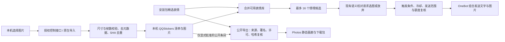

# 表情库与 Photos 画廊

## 使用

Web 与 macOS 客户端的「范围与回复」提供同一套配图设置：

- 按语境与条数：保留原有的强烈情绪与定期配图规则。
- 指定情绪：仅在勾选情绪下配图，同时保留条数和强烈情绪条件。
- 关键词：当前消息含任意指定关键词时可配图，不需要额外一次模型调用。
- 全部模式仍经过语义校对、同图去重、发送间隔、会话白名单与额度检查；无贴题图片就不配。不主动创造一次回复，也不保证命中关键词就一定发图。

在「导入本机表情」选择静态 PNG / JPEG / WebP，设置情绪、适用情境与来源。每批最多 50 张、每张最多 3 MB。服务核对帧数和尺寸、转为无原始元数据的 PNG、按 SHA-256 去重。图片与清单存放于应用数据目录下的 `QQStickers`，权限分别为 0600 / 0700，重启保留，更新安装包不覆盖。

「已确认可公开分享」只记录发布意愿，需要作者、许可与公开来源；勾选不会触发上传。未勾选图片不进入网站或下载包。面板操作需要当前控制页授权；QQ 运行中需先暂停。macOS 原生客户端与 Windows/WSL Web 面板共用导入校验与发送规则。



发送复用 `QQEngine → DeepSeekClient.reviewedQQReply → QQStickerLibrary.shortlist` 的既有生成与校对链路，不增加专门的选图模型调用。`QQPersona.permitsSticker` 只决定合法回复能否带图，不产生回复，也不替代发送前的运行代次、主人接话、名单与额度检查。Web 导入入口 `/api/import-sticker` 仍只监听本机并核对当前令牌、Host 与 Origin；仅该入口放宽图片请求大小，其他操作维持原有大小上限。

## 资源来源

原有 4 张原创示例为 CC0。新增 33 张精选表情来自 [Pysio Chibi](https://github.com/pysio2007/emoji/tree/b76af11018348fcab3a4861e41995f17a8eabd1e/Chibi)，固定版本 `b76af11018348fcab3a4861e41995f17a8eabd1e`，保留完整 `PYSIO-LICENSE.txt` 与逐图作者、来源、SHA-256。图片按上游 CC BY-NC-SA 4.0 提供，项目 MIT 不覆盖其许可。

社区同步脚本只下载显式筛选清单，不在机器人运行时抓取或自动扩充：

```bash
python3 scripts/collect-community-stickers.py
```

旧版本地图库的已知来源声明需逐项沿用：合集的角色设计许可不等于所有表情图的许可，`personal` 图包不能进入公共下载包。用户本地使用与公开再分发分别记录。

## 构建与部署

目标域名由用户指定为 **photos.lifanhu.me**。画廊是纯静态站点，只有可公开图片及来源清单，没有 QQ、控制令牌、聊天、记忆、账号配置和上传接口。

```bash
python3 scripts/build-photo-gallery.py dist/photos-release
# 若另有已逐项核对的本机公开清单，可显式加入：
python3 scripts/build-photo-gallery.py dist/photos-reviewed --include-local /path/to/reviewed-stickers
python3 -m http.server 8080 --directory dist/photos-release --bind 127.0.0.1
```

已有输出目录会被拒绝，避免混入上轮文件。构建逐图核对文件名、软链接、大小、SHA-256、公开意愿、来源与署名；只导出白名单字段。提供搜索、情绪筛选、大图预览、上一张/下一张、复制图片链接、单图下载及整包下载。

### 发布通道

按用户最新指示，日常发布沿用 `my.lifanhu` 的 GitHub Actions，不另走本机手工上传，不以 AWS 登录作为已有流水线发布的前提。服务器 Secret 保存在该仓库；本公开仓库不复制其值。

目前画廊尚未接入这条通道：`my.lifanhu` 的发布器只接受 `homepage`、`account-web`、`account-app`，而本仓库现有工作流只执行 macOS、Linux/WSL 检查。推送本仓库不会自动把图片发布到 `photos.lifanhu.me`。后续需为画廊建立固定源码版本、构建产物、发布组件、回滚与公网验证的对应关系，再走 GitHub 发布；不能用一次首页发布替代。

跨项目的本机入口索引位于代码库目录外的「代码库配置说明.md」，父目录 `AGENTS.md` 已指向该文件。共享索引仅留在本机，不打包进公开仓库。

### 首次接入需核对的服务器条件

以下是未来发布流程需要承担的条件清单，不是当前要求用户手工操作的发布教程：

1. 核对现有服务器、磁盘余量、Caddy / HAProxy 配置和各服务健康；不改已有网站和代理路由。
2. 上传候选发布目录到 `/srv/dafeiyu-photos/releases/<release>`，与本地逐文件核对 SHA-256；保留前一版本以便回滚。
3. DNS 新增 `photos` 指向现有服务器。当前架构由 HAProxy 在 443 依据 SNI 分流，需要仅把新域名加入现有网站后端的域名匹配条件，其他域名和默认后端保持原样。
4. 参考 `deploy/photos/photos.caddy.example`，将示例域名替换为用户确定的域名，合并到现有 :9443 HTTPS 布局。确认现有证书签发方式；外部 443 经 HAProxy 转发，不可直接套用另一台服务器的端口或挑战配置。
5. `caddy validate` 与 `haproxy -c` 通过，候选站点本机验证通过后再原子切换 `current` 并平滑重载。不得把本机 QQ 控制接口反向代理到公网。
6. 公网检查 TLS、首页、图片、清单、ZIP 下载，以及原有首页、Account 和服务健康。失败切回前一目录和此次配置备份。

源码、静态构建、本机浏览器验证、服务器上传、DNS、HTTPS 与公网验收分别记录。没有服务器连接权限或 DNS 通道时，候选配置不能标为已部署。

## 本轮验证记录（2026-10-25）

- 完整自动化检查：85 项应用测试、77 项核心测试通过；新增导出隐私边界测试 2 项通过。最终改动另执行表情导入与触发规则定向回归。
- 100 张旧版本地表情通过已鉴权的本机导入接口完成校验，全部成功；与 37 张安装包资源合并为 137 张。恢复到正式应用的本地表情数据目录，未改账号配置、运行状态或计数；旧进程需要重新打开新版才能载入新增本机库。
- Chrome 画廊验证了情绪筛选、关键词搜索、大图与下一张预览；390 像素宽度下无横向溢出，标题保持两行。导出包逐图保留来源、作者与许可。
- 原生客户端构建、签名验证通过，生成 19 张合成界面预览，包含新表情库窗口；原生实际点击与文件选择尚未验收。
- Chrome 自动选择本地文件因扩展未开放 file URLs 权限而受阻；接口批量导入已验证，不能把它写成浏览器文件选择已验收。未因此修改浏览器扩展权限。
- 本机验证环境没有连接真实 QQ、没有调用模型、没有发送测试消息。运行在线不代表新增配图语义质量已获真人确认。
- 部署状态更正：用户指定沿用 `my.lifanhu` 的 GitHub 发布通道，不另走手工上传；已有流水线不依赖本机 AWS 登录。画廊尚未接入该通道，本轮未上传资源、未修改 DNS、未重载生产服务，`photos.lifanhu.me` 尚未完成公网验收。
- GitHub 已核对：提交 `ee66f44deeb0282459ca31c9290c40bf2ec36a89` 的 macOS 与 Linux/WSL 工作流均成功；这属于提交检查证据，不是服务器发布证据。
