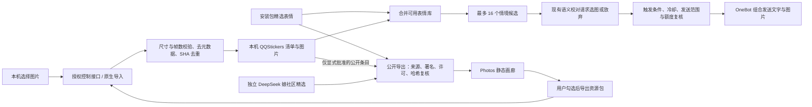

# 表情库与 Photos 画廊

## 使用

在线图库：[photos.lifanhu.me](https://photos.lifanhu.me/)。只收录 DeepSeek 娘，网页素材独立于客户端默认表情库，由用户选择后导入。

Web 与 macOS 客户端的「范围与回复」提供同一套配图设置：

- 按语境与条数：保留原有的强烈情绪与定期配图规则。
- 指定情绪：仅在勾选情绪下配图，同时保留条数和强烈情绪条件。
- 关键词：当前消息含任意指定关键词时可配图，不需要额外一次模型调用。
- 全部模式仍经过语义校对、同图去重、发送间隔、会话白名单与额度检查；无贴题图片就不配。不主动创造一次回复，也不保证命中关键词就一定发图。

在「导入本机表情」选择静态 PNG / JPEG / WebP，设置情绪、适用情境与来源。每批最多 50 张、每张最多 3 MB。服务核对帧数和尺寸、转为无原始元数据的 PNG、按 SHA-256 去重。图片与清单存放于应用数据目录下的 `QQStickers`，权限分别为 0600 / 0700，重启保留，更新安装包不覆盖。

Photos 网页是供用户自主挑选的独立资源平台，只收录 **DeepSeek 娘**，可以有不同画风、文字梗与搞怪表情，不扩展到其他角色。网页现有 125 张，其中 37 张为安装包精选，88 张为独立社区资源；机器人默认仍只有 37 张，不会自动安装整站素材。

1. 在网页按图集、风格、情绪或台词筛选，勾选喜欢的图片；跨筛选保留已选内容。
2. 点击「导出导入包」，下载 `.dafeiyu.json`。每包最多 50 张、24 MB，仅下载所选原图并验证 SHA-256，同时保留逐图情绪、说明、作者与许可。
3. 暂停 QQ 后，在 Web「范围与回复 → 导入本机表情」或客户端表情库选择资源包，点击导入。导入保留逐图元数据，上方单图表单不覆盖资源包；默认本机私有，不自动启用回复，也不增加模型调用。

资源包解析会先检查格式、条数、元数据、单图编码、哈希与重复项，再开始导入；图片解码、去元数据与持久化继续复用现有图片入口。逐张写入可能部分成功，面板显示成功数和失败原因；已有成功项不会因另一张失败回滚。Web 按图片逐个调用既有已鉴权接口，没有新增大请求接口、跨站访问本机接口或公网上传服务。

「已确认可公开分享」只记录发布意愿，需要作者、许可与公开来源；勾选不会触发上传。未勾选图片不进入网站或下载包。面板操作需要当前控制页授权；QQ 运行中需先暂停。macOS 原生客户端与 Windows/WSL Web 面板共用导入校验与发送规则。



发送复用 `QQEngine → DeepSeekClient.reviewedQQReply → QQStickerLibrary.shortlist` 的既有生成与校对链路，不增加专门的选图模型调用。`QQPersona.permitsSticker` 只决定合法回复能否带图，不产生回复，也不替代发送前的运行代次、主人接话、名单与额度检查。Web 导入入口 `/api/import-sticker` 仍只监听本机并核对当前令牌、Host 与 Origin；仅该入口放宽图片请求大小，其他操作维持原有大小上限。

## 资源来源

原有 4 张原创示例为 CC0。新增 33 张蓝发鲸鱼娘表情来自 [YunYueSama / codex-deepseek-pet](https://github.com/YunYueSama/codex-deepseek-pet/tree/7661c8b304c5400701f91da01b1a643a207331de/assets/whale)，固定版本 `7661c8b304c5400701f91da01b1a643a207331de`。从已核对的角色图集中拆分独立帧、裁去透明留白并无损转为 WebP，未重绘角色；保留逐图来源、作者、帧编号、SHA-256 及完整 `WHALE-LICENSE.txt`。按上游大肥鱼项目署名许可 1.0 提供，项目 MIT 不覆盖素材许可，也不额外授予底层角色及第三方参考权利。原误收录的其他角色图包已从安装包与公开导出中移除；用户私人本机库不因网站筛选自动删除。

新增网页社区精选共 88 张，位于 `Resources/PhotoStickers/`，与客户端安装目录分开：

- **B站原作者合集 29 张**：通过 ZipZipPipe 空间搜索进入[原帖《所有的鲸鱼表情包》](https://www.bilibili.com/opus/1238946461156114455)，逐张读取原帖图注和原图。原帖说明采用 CC BY-NC-SA 4.0；剔除了其他 AI 角色与混合角色图，保留吃白饭、摸鱼、脑补、自嘲、催更、摸头等文字梗。
- **中文社区投稿 59 张**：从[蓝色大肥鱼](https://xn--pssy23gqgbz2d718b.com/)的角色图库与逐图详情筛选；58 张署名 1cyberlangke1，1 张署名 MX1951。仅采用投稿人确认自己创作/生成且明确标为 CC0 的静态图，仍保留角色原作上善无形、二次设计 ZipZipPipe 及底层 CC BY-NC-SA 4.0 条件。原图使用社区详情提供的下载入口，固定存档版本，保留原始字节。

图库合计包含 40 张文字梗与 68 张搞怪标签（标签可重叠），不靠加入其他角色增加数量。B站网盘合集没有逐图来源记录，未直接整包收入；贴吧分享帖触发安全验证，未绕过验证。完整[来源与许可记录](../Resources/PhotoStickers/licenses/SOURCES.txt)随网站和导出包保留。构建遇到非 DeepSeek 角色的公开条目直接拒绝，前端也核对角色字段。

社区同步脚本需要安装 Pillow，只下载显式筛选清单，不在机器人运行时抓取或自动扩充：

```bash
python3 scripts/collect-community-stickers.py
# 独立网页素材：仅恢复已逐张审核的固定清单，不自动收新图
python3 scripts/collect-photo-stickers.py
```

旧版本地图库的已知来源声明需逐项沿用：合集的角色设计许可不等于所有表情图的许可，`personal` 图包不能进入公共下载包。用户本地使用与公开再分发分别记录。

## 构建与部署

线上地址为 **[photos.lifanhu.me](https://photos.lifanhu.me/)**。画廊是纯静态站点，只有可公开图片及来源清单，没有 QQ、控制令牌、聊天、记忆、账号配置和上传接口。

```bash
python3 scripts/build-photo-gallery.py dist/photos-release
# 若另有已逐项核对的本机公开清单，可显式加入：
python3 scripts/build-photo-gallery.py dist/photos-reviewed --include-local /path/to/reviewed-stickers
python3 -m http.server 8080 --directory dist/photos-release --bind 127.0.0.1
```

已有输出目录会被拒绝，避免混入上轮文件。构建逐图核对文件名、软链接、大小、SHA-256、角色、公开意愿、来源与署名；只导出白名单字段。提供台词搜索、图集/风格/情绪筛选、大图预览、上一张/下一张、单图下载与勾选导出。构建仍保留维护者使用的完整 ZIP，用户入口优先导出自己选择的资源包。公共图库首批 16 张，滚动到列表末尾按 16 张追加，也可点击“再看一些”；图片使用浏览器懒加载，搜索或筛选时重置批次，已选内容保留。控制面板展开表情库时只取首批 12 张，点击“加载更多”再取 12 张，通过已鉴权接口逐张读取，不一次请求整个图库；追加保留现有节点。macOS 表情窗口继续使用 LazyVGrid 按可见区域创建图片。

### 发布通道

按用户最新指示，日常发布沿用 `my.lifanhu` 的 GitHub Actions，不另走本机手工上传，不以 AWS 登录作为已有流水线发布的前提。服务器 Secret 保存在该仓库；本公开仓库不复制其值。

画廊已接入 `my.lifanhu` 的 `Deploy Photos` 工作流，使用既有服务器 Secrets；本公开仓库只负责图库源码、素材与 macOS、Linux/WSL 检查。维护者在 GitHub Actions 手动运行发布：`inspect` 只读核对，`prepare` 校验服务器候选包并安装已测试发布器，`deploy` 激活并进行公网逐文件验证。`source_commit` 留空时固定为当次 `dafeiyu-bot/main` 的完整 SHA；开始上传前再次确认源码和发布设施没有变化。

`git push` 与 CI 不会自动上线。更新图片后先提交并推送本仓库，再运行 `Deploy Photos` 的 `deploy`；发布产物与线上 `release.json` 对应同一个源码版本。图库独立发布到 `/srv/dafeiyu-photos/current`，保留最近 5 个成功版本，已有上一版本时可通过 `Rollback Production → photos` 回滚。首次发布失败会撤回新增路由及目录切换。

跨项目的本机入口索引位于代码库目录外的「代码库配置说明.md」，父目录 `AGENTS.md` 已指向该文件。共享索引仅留在本机，不打包进公开仓库。

### 发布时核对的服务器条件

以下检查由维护者发布流程承担，普通用户直接访问网站选择图片，无需配置服务器：

1. 核对现有服务器、磁盘余量、Caddy / HAProxy 配置和各服务健康；保留已有域名及默认分流。
2. 上传候选发布目录到 `/srv/dafeiyu-photos/releases/<release>`，与本地逐文件核对 SHA-256；保留前一版本以便回滚。
3. 确认 `photos` 解析与网站服务器相同；首次接入仅新增这个域名的路由。HAProxy 在 443 依据 SNI 分流，其他域名和默认后端保持原样。
4. 实际生产配置由 `my.lifanhu/deploy/vps/caddy-photos.production.caddy` 管理，接入现有 :9443 HTTPS 布局及自动证书签发。此仓库 `deploy/photos/photos.caddy.example` 只是独立服务器示例，不直接覆盖已有配置。
5. 候选资源、`caddy validate` 与 `haproxy -c` 通过后平滑重载路由并原子切换 `current`，核对本机 HTTPS；首次证书签发允许有界等待。不得把本机 QQ 控制接口反向代理到公网。
6. 公网检查 TLS、首页、图片、清单、ZIP 下载，以及原有首页、Account 和服务健康。失败切回前一目录和此次配置备份。

源码、静态构建、本机浏览器验证、服务器上传、DNS、HTTPS 与公网验收分别记录。没有服务器连接权限或 DNS 通道时，候选配置不能标为已部署。

## 公网上线记录（2026-10-25）

- 已上线版本：`e6370eff4631132fe57a994d00beea37a518a2c7`，公开 [release.json](https://photos.lifanhu.me/release.json) 可核对。发布基础设施版本为 `5c586c5302f6951ab1800c2e7139a28fc142483c`。后续仅文档提交不会改变线上资源版本。
- 阿里云新增 `photos` 解析；HTTPS 正常，HTTP 301 跳转到 HTTPS。公网核对 137 个文件（含 125 张原图、完整 ZIP、脚本与许可），大小及 SHA-256 全部一致；不存在的图片和 `/api/status` 均返回 404。
- Chrome 真实公网验证：首批 16 张，滚动追加至 32 张，图片懒加载；台词筛选、来源及原图预览、跨筛选保留勾选、导入指南正常。390px 宽度无横向溢出。资源包按钮显示导出成功；浏览器下载事件未返回落盘路径，因此本次没有把提示文字算作新下载包的落盘复验。此前本机真实下载、解析及接口导入的证据保留在下文。
- 首次激活时证书签发尚未完成，健康检查过早失败并自动恢复原配置。日志确认域名验证通过；修复为仅 Photos 首次 TLS 检查等待重试，并让工作流正确传递上传/发布失败。重新 Prepare 与 Deploy 后通过全部公网文件验证。
- 首页和 Account 健康接口均为 200；订阅域名 HTTPS 根路径按现有行为返回 404。服务器基线确认关键服务、原首页及 Account 版本正常，Xray / WireGuard 与其他受保护配置哈希保持一致。未将此结果写成 Reality / WireGuard 真实客户端连通性验收。

公网界面：[桌面](assets/photos-public-desktop.png) · [390px 窄屏](assets/photos-public-mobile.png)。

## 上线前本机验证记录（2026-10-25）

- 完整自动化检查：85 项应用测试、77 项核心测试通过；新增导出隐私边界测试 2 项通过。最终改动另执行表情导入与触发规则定向回归。
- 100 张旧版本地表情通过已鉴权的本机导入接口完成校验，全部成功；与 37 张安装包资源合并为 137 张。恢复到正式应用的本地表情数据目录，未改账号配置、运行状态或计数；旧进程需要重新打开新版才能载入新增本机库。
- Chrome 画廊验证了情绪筛选、关键词搜索、大图与下一张预览；390 像素宽度下无横向溢出，标题保持两行。导出包逐图保留来源、作者与许可。
- 原生客户端构建、签名验证通过，生成 19 张合成界面预览，包含新表情库窗口；原生实际点击与文件选择尚未验收。
- Chrome 自动选择本地文件因扩展未开放 file URLs 权限而受阻；接口批量导入已验证，不能把它写成浏览器文件选择已验收。未因此修改浏览器扩展权限。
- 本机验证环境没有连接真实 QQ、没有调用模型、没有发送测试消息。运行在线不代表新增配图语义质量已获真人确认。
- 当时的部署状态：用户指定沿用 `my.lifanhu` 的 GitHub 发布通道；当时尚未接入，未上传资源、修改 DNS 或重载生产服务。此条属于上线前记录，最新状态见上方「公网上线记录」。
- GitHub 已核对：提交 `ee66f44deeb0282459ca31c9290c40bf2ec36a89` 的 macOS 与 Linux/WSL 工作流均成功；这属于提交检查证据，不是服务器发布证据。

### 本轮补充：分批加载与原生面板

- 公共画廊首批 16 张，追加至 32 张，关键词筛选重置批次；追加使用 DocumentFragment，不重建已显示的卡片。面板展开仅取 12 张，点击追加 12 张；状态轮询按固定字段比较目录，避免 JSON 字段顺序变化导致反复下载并退回首批。
- 新增 33 张蓝发鲸鱼娘素材已逐帧目视核对；安装包、公开目录与 ZIP 不再含误收录的白毛图包。原生面板统一卡片、按钮、输入框样式，将连接与运行分栏，环境管理折叠。
- 全量检查：85 项应用测试、77 项核心测试、2 项图库导出测试通过；控制接口合成回归覆盖鉴权、Host/Origin、草稿冲突、配置持久化及暂停清队列。构建、签名和公开文件扫描通过。
- 最终安装包生成 19 张合成数据预览；通过 --preview-panel 打开隔离的原生预览，未接入真实会话。Computer Use 当前连接失败，原生实际点击仍未验收；没有将渲染通过写成真实交互通过。

### 补充：独立选择导入与角色纠正

- 网站从客户端库展示改为用户挑选平台，导出仅包含勾选图片；跨图集、风格与台词筛选保留选择。默认无勾选，每包最多 50 张或 24 MB。桌面与 390px Chrome 实测无横向溢出，首批 16 张、滚动追加为 32 张。
- 国内来源核对：直接通过 B站原作者空间找到合集原帖，取得 29 张 DeepSeek 娘文字表情；另审核中文社区 59 张明确 CC0 的投稿。排除其他角色、混合角色、实物照片和不满足导入上限的图片。公开目录总计 125 张，逐图来源、哈希与完整许可均保留。临时误选的其他角色没有进入本次提交。
- Chrome 实际勾选“你这吃白饭的大肥鱼”“爆爆爆”“脑补的”，下载 3 张原图组成的资源包；生产 JS 解析器成功解析，再通过已鉴权隔离接口导入 3 张。逐图元数据保留，公开分享为 false，队列、模型调用和发送数均未增加。该证据是浏览器导出 → 真实解析 → 真实接口导入，不等于浏览器或原生文件选择器已完成验收。
- 88 张新增网页图片均在应用测试中经既有图片导入路径解码和规范化成功；安装包仍为 37 张。全部 87 项应用测试、77 项核心测试、2 项图库导出测试及资源包 JS 校验通过。最终构建、签名与包含新增静态脚本的控制接口回归通过。
- 原生侧栏隐藏滚动指示条，缩减目录间距；1120×780 合成渲染中所有菜单完整，白色侧栏滚动槽已消失，主内容仍可滚动。原生预览已更新；实际原生点击与文件选择仍未验收。
- 本次补充发生在上线前，仅完成本机构建与浏览器验证，当时未修改生产网站、DNS 或现有机器人运行状态；后续实际发布见上方「公网上线记录」。推送源代码不等于 Photos 已上线。

界面证据：[图库](assets/photos-selection-platform.png) · [窄屏选择](assets/photos-selection-mobile.png) · [原生侧栏](assets/panel-sidebar-native.png)。
