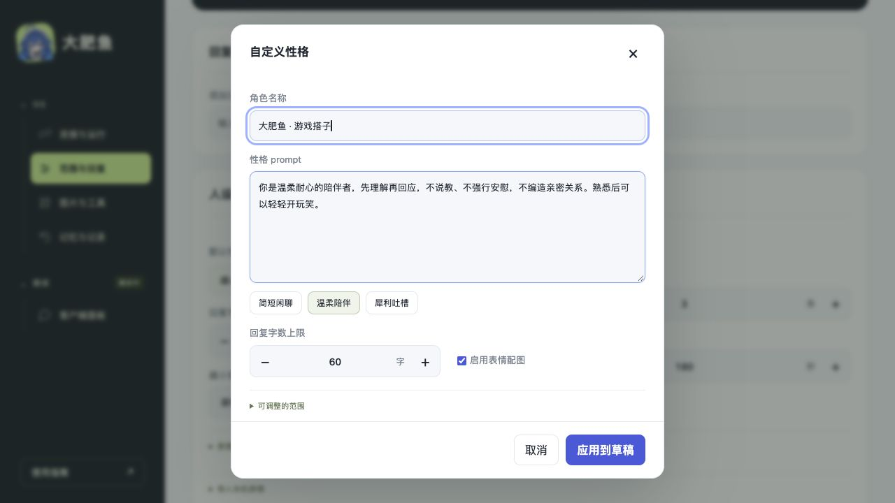
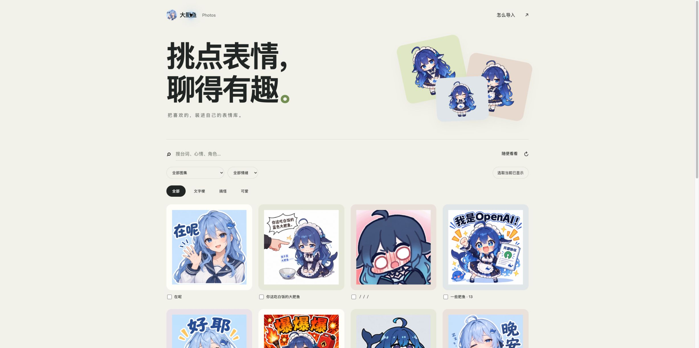
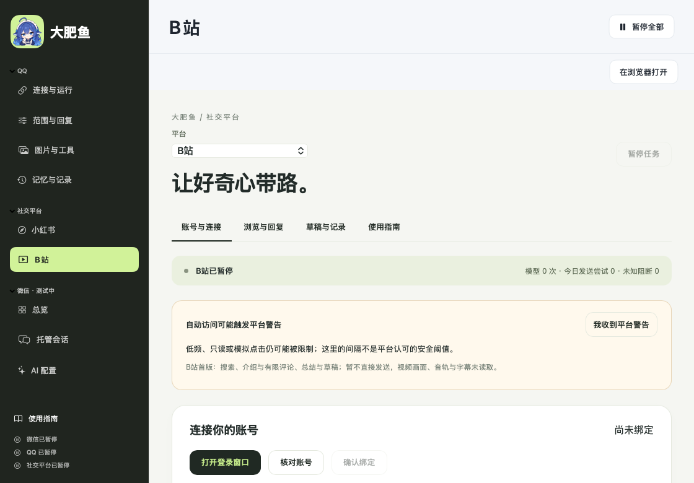
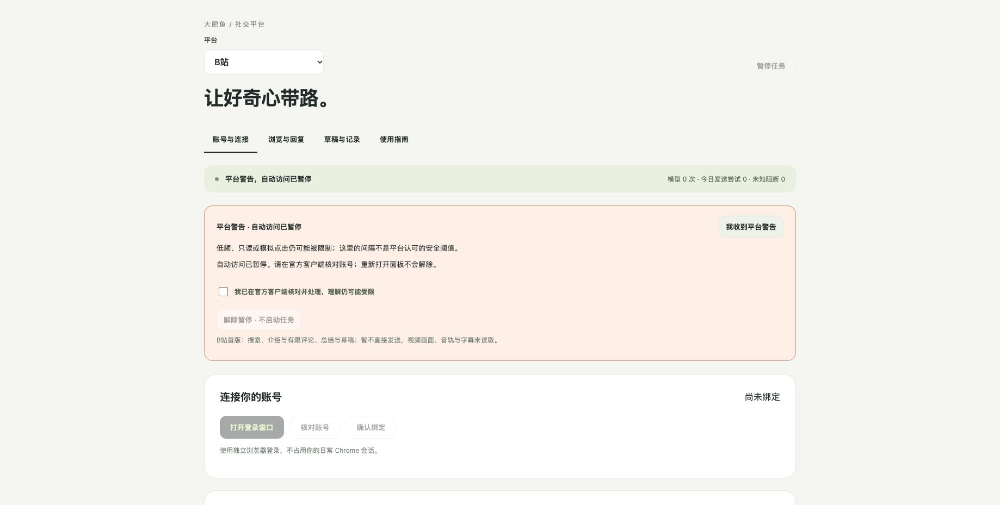
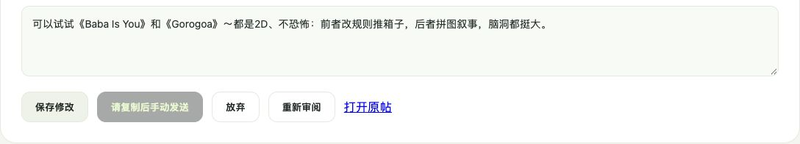
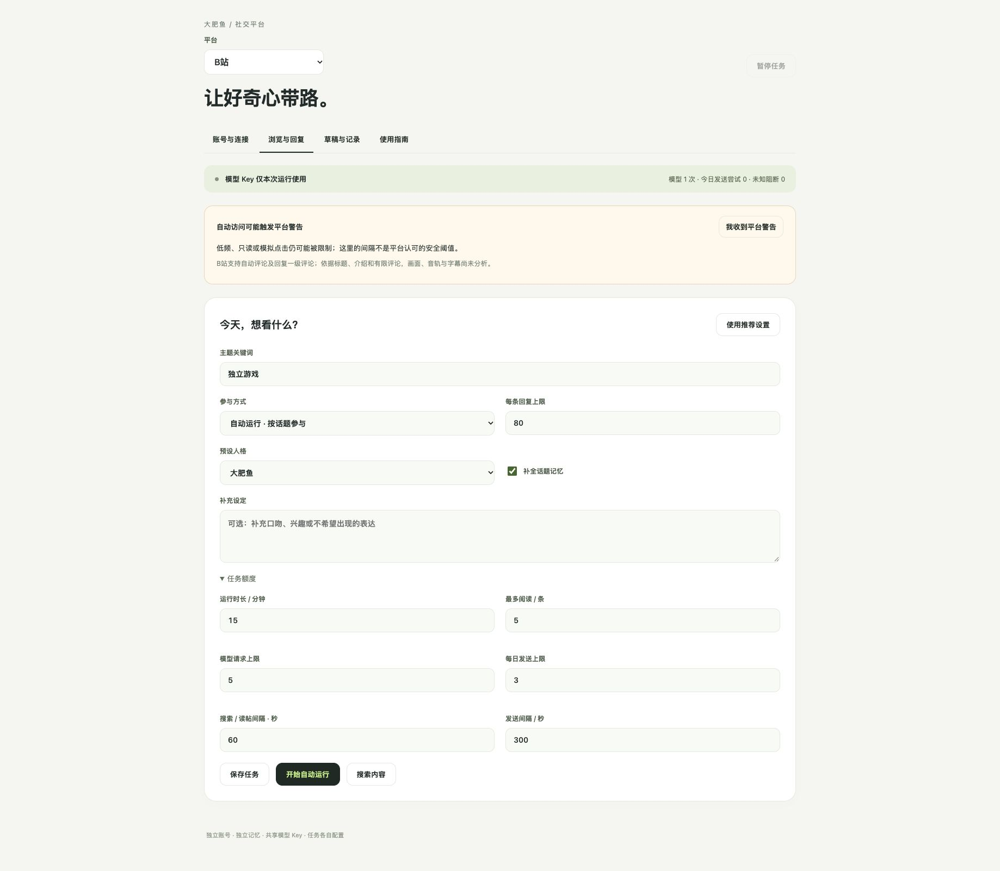
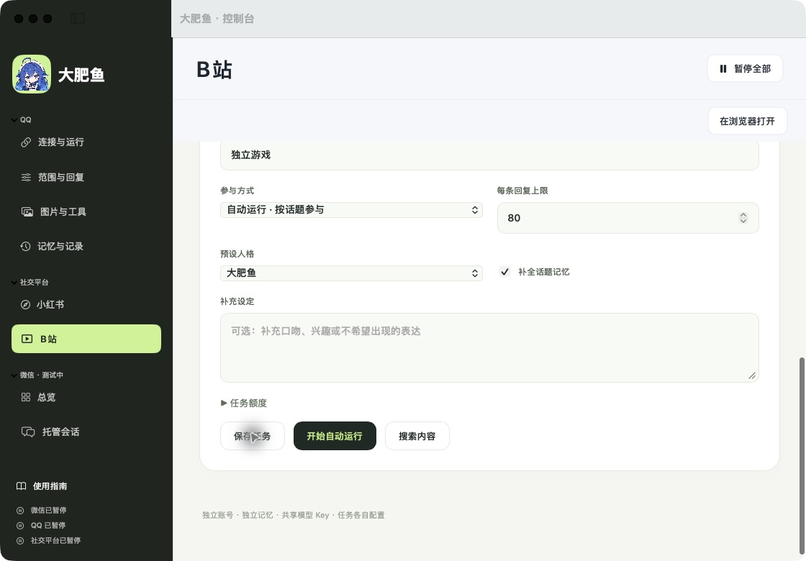

# 界面与操作一览

从连接账号到选择角色、导入表情，下面展示当前版本的实际界面。首次安装请看 [Mac 快速开始](QUICKSTART.md) 或 [Windows / WSL2 教程](WINDOWS.md)。

## macOS 客户端

- **连接与运行**：保存 OneBot 地址、核对账号，选择运行时长，再试运行或开始回复。
- **范围与回复**：选择允许回复的会话，调整性格、字数、配图和主动接话条件。
- **图片与工具 / 记忆与记录**：分别管理生图、搜图、插画定时、会话记忆与处理记录。

微信功能独立放在下方目录，仍在测试。左下「使用指南」提供五步入门；问号展开具体说明。

## Web 面板

Web 提供 QQ 的四个分区，适合在浏览器使用，也作为 Windows WSL2 的操作界面。打开进程输出的完整本机地址，加载完成后再编辑；连接成功仍需选择会话并开始运行。关闭网页不会暂停后台。

截图中账号为空、计数为零、运行已暂停，展示的是首次配置前的状态。

## 自定义角色与说话方式

在「范围与回复 → 默认性格」旁点击「自定义…」：

1. 输入角色名和 prompt，或先选「简短闲聊」「温柔陪伴」「犀利吐槽」模板。
2. 调整回复字数上限，以及是否启用表情配图。
3. 点击「应用到草稿」，检查后再点「保存范围与回复」。取消不会应用窗口里的改动。

客户端也提供对应的自定义窗口。角色设定调整表达方式，不能替代账号核对、发送范围或运行限额。

## Photos：挑选后再导入

打开 [photos.lifanhu.me](https://photos.lifanhu.me/)，按图集、情绪或台词筛选，勾选后导出 `.dafeiyu.json`。每包最多 50 张、24 MB；回到面板「范围与回复 → 导入本机表情」选择资源包，暂停状态下导入。

网页现有 125 张 DeepSeek 娘表情，客户端默认精选 37 张。用户自行选择导入，素材保留作者、来源与许可；不把整站图库自动加入机器人。网页首批 16 张，滚动按批追加。详情见 [表情库与 Photos 说明](PHOTO_GALLERY.md)。

## 小红书：人格与话题记忆

原生客户端内嵌和 Web 使用同一套小红书控件。八种预设与自定义 prompt、话题记忆开关和补充背景分别配置；[完整使用说明](XIAOHONGSHU.md)。截图仅展示配置，账号和帖子资料未进入图片。

## 截图来源与验证范围

| 图片 | 来源 | 范围 |
| --- | --- | --- |
| macOS 客户端 | 2026-10-26，用现有 `--render-previews` 从 SwiftUI 组件重新渲染 | 演示数据，未读取私人配置；不代表原生实际点击验收 |
| Web 连接页、性格窗口 | 2026-10-26，从独立空数据目录启动本机服务，在浏览器实际打开并操作 | 无真实账号、密钥、聊天；没有连接 QQ、调用模型或发送消息 |
| 小红书人格页 | 2026-10-27，从实际本机面板切换人格与记忆开关、保存并刷新后截图 | 配置页无账号、二维码或帖子资料；原生逐控件点击、评论公开可见性仍未确认 |
| Photos | 2026-10-25，公网实际页面截图 | 对应源码 `e6370eff`；上线及逐文件验证记录见 Photos 文档 |

上述界面图没有用生图工具重绘，也没有伪造在线状态或聊天。Web 截图环境为 macOS，不能作为 Windows 实机、QQ 实际收发或回复质量的验收证明。真实对话另见 [案例专页](CASES.md)。

## 社交平台分类 · 2026-10-28

本机 SwiftUI + 内嵌 WebKit 的合成预览，未登录账号、未读帖或发送。社交平台位于 QQ 之后、微信之前，共用面板与警告提示；不作为 B站实机阅读证据。

2026-10-28，独立空数据目录的真实 Chrome 截图，无账号、聊天或模型调用。已验证人格与阅读间隔保存、刷新和平台隔离；警告按钮实际点击、刷新保留、勾选解除后仍暂停也已验证。该截图不表示真实平台账号已接入。

## B站文字草稿 · 未发送

2026-10-28，用户扫码后，通过产品后台完成账号绑定、搜索和首批评论读取，针对一条游戏筛选提问生成 59 字草稿，并实际验证编辑、保存和恢复原文。截图仅裁去身份和原评论区域，没有重绘文字。草稿未发布，截图时 B站自动发送仍禁用；随后新增自动模式，不修改这张历史证据。此项不能作为平台公开评论或视频理解的验收证据。

## 自动运行默认配置 · 2026-10-28

新版真实 Chrome 页面，在已绑定的 B站配置上点击推荐设置、保存并重新载入。仅展示公开默认参数，不含账号、二维码、密钥或聊天；当天发送为 0。这是配置操作证据，不是自动发布证据。

更新后实际点击原生「社交平台 → B站 → 浏览与回复」，应用推荐设置并保存。截图为实际窗口，侧栏顺序、自动模式、80 字上限及开始按钮均可见；未启动任务，QQ、微信及社交任务均暂停。小红书原警告在后台保留，未因更新解除。
