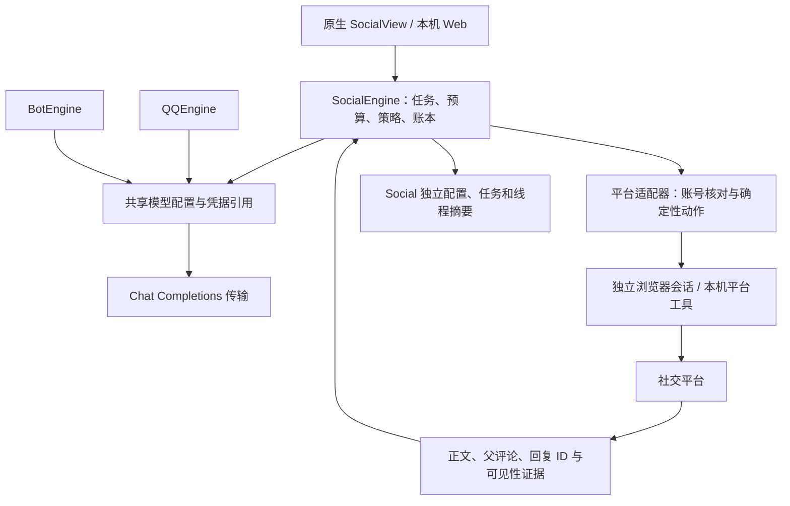

# 社交浏览与回复代理 · 技术方案

版本：v0.3，2026-10-27。源码基线：`edf05b8524d5e32a3a4cadf177df2c6c37da7d5f`。调研档案：`20261026-social-browsing-agent`。下面先列首版实施对照；后续 v0.2 原设计保留为后续开发依据，不能把其中所有拟定接口当作已实现。

## 社交平台调整 · 2026-10-28

最新范围与实现见 [社交平台共享方案](SOCIAL_PLATFORMS.md)：目录为 QQ → 社交平台（小红书 / B站）→ 微信；共享引擎、人格、模型凭证访问和面板，平台状态独立。B站已实测扫码、绑定、搜索、文字与有限评论读取、模型草稿和记忆，本轮随后新增两站默认自动模式与B站发送/回读契约，真实B站评论发布仍待验收；平台警告持久暂停，阅读间隔独立配置。以下首版和更早方案保留为历史，不能据此宣称小红书优先等于账号安全。

## 首版实施对照 · 2026-10-27

用户已要求按推荐思路实现同级小红书板块。本轮采用自有 Playwright 执行器；没有直接运行原 Go MCP 评论动作。原因是原执行器取消、精确目标和结果证据未满足写入条件，自己持有浏览器可以在实际请求发出前校验目标、内容并限制一次转发。

| 范围 | 本轮实际实现与边界 |
| --- | --- |
| 入口 | 原生导航新增小红书，内嵌 WebKit 与浏览器使用同一套 Web 控件、SocialEngine；CLI 为 `--xiaohongshu-panel` |
| 执行器 | `Resources/SocialBrowser/browser.mjs`、固定 Playwright 1.64.1、本机独立 Chrome Profile、独立鉴权回环端口；默认不启动浏览器 |
| 模型共享 | 默认引用已有 DeepSeek `api-key`，不改 QQ 模型；其他兼容服务可在小红书单独配置。完整 ModelProfile 公共编辑器、control-hub 跨模块临时 Key 容器未实施 |
| 读与写 | 主题搜索、正文和有限评论、草稿/摘要、编辑确认、有限时自动参与；只支持顶层评论及回复一级评论，不猜测深层或折叠父评论。图片和视频主体尚未分析 |
| 人格与记忆 | 八种预设及自定义；小红书按账号、帖子隔离的滚动摘要（400 字）、手动背景（1000 字）与最近五条发送记录，七天 / 最多 200 话题；与草稿合并一次模型调用，支持关闭、校正与清除；不是跨平台私人记忆或全站通知监听器 |
| 控制协议 | `GET /api/status`、`POST /api/action`、`GET /api/job/<requestID>`；命令字段以 SocialDomain.swift 的 SocialCommand 为准，账号操作也由 action 完成，不额外创建原计划的账号 REST 路由 |
| 生命周期 | 独占状态文件锁；发送前原子保存预留和目标；过期/暂停使旧 runID 无效；重启发送中记录转未知；人工重新审阅生成新五分钟确认任务 |
| 验证 | 174 项 Swift 测试、页面契约、构建及本机 Web 操作分别检查；真实登录、搜索、有限阅读、DeepSeek 草稿与记忆已验证；用户明确授权后仅提交一次，获得新评论 ID（accepted）；页面回读与公开可见性未确认，不宣称完整互动验收 |

本轮使用与配置入口见 [小红书使用说明](XIAOHONGSHU.md)。以下为原 v0.2 详细设计，未实施部分以上表为准。

## 上下文与决策基础

目标是在大肥鱼中增加「社交浏览」，与 QQ、微信并列。AI 能按兴趣搜索、读帖、理解评论，再选择不参与、保存草稿或在用户设定的范围内回复。共享必要的模型配置与 API 凭据，不共享整套账号、队列和私人聊天。

一个验收例子：用户选择平台、账号和“独立游戏”主题，启动 30 分钟任务；代理阅读帖子及指定评论，生成贴题短回复。用户确认一次具体草稿，或事先启用受限自动回复后，程序只向绑定账号和精确目标提交一次，并显示实际提交、接受或可见状态。暂停社交任务不影响 QQ。

| 类别 | 设计依据与当前结论 |
| --- | --- |
| 用户明确要求 | 新板块与 QQ / 微信独立，支持必要数据共享；本轮产出调研及技术方案 |
| 已核实现状 F1 / F2 | 现有客户端与本机 Web、DeepSeek 客户端、钥匙串、QQ 独立队列及落盘账本均有源码；模型传输写死 DeepSeek 地址，工具定义绑定 QQ |
| 决定 D1，用户要求 | 同产品新增独立模块；不通过 QQ 的队列或 OneBot 执行社交动作，不新建一套云服务 |
| 建议 D2 / D3 | 结构化平台工具优先；共享模型配置和凭据引用；默认“浏览与草稿”，按任务启用确认回复或规则自动回复 |
| 平台选择 Q1 | 用户已选择“先比较，再推荐首个平台”；工程建议小红书 → B站 → 知乎 → 微博，不把推荐等同于用户已授权接管或发送 |
| 未验 A2 | 上游工具尚未在本项目的真实账号下验收；目标定位、账号核对、提交确认、浏览器打包仍可能改变首个适配器选择 |

**编写状态：条件性实施方案。** 已核实社区源码和本项目的复用边界；没有安装这些工具、接管社交账号、调用付费模型或实际发表评论。主架构可推进，平台写能力须经过后文门槛再开启。

## 1. 社区方案与经验

### 1.1 本次核对的候选

只用项目原仓库、源码、作者文档与一手 Issue / PR 作为技术依据。下表对应 2026-10-26 固定提交；活跃度和功能列表不代表本机实测成功。

| 项目与固定版本 | 能力与适用位置 | 取舍 |
| --- | --- | --- |
| [xiaohongshu-mcp](https://github.com/xpzouying/xiaohongshu-mcp/tree/7797fd375aba02dcd33afe143f6bee13e5870859) `7797fd3` | Go / Rod；登录、信息流、搜索、详情、评论、楼中楼回复；有 REST 和 MCP 入口 | 建议作为小红书首个候选；Apache-2.0。写动作须补精确定位和可验证结果，不能原样启用自动回复 |
| [OpenCLI](https://github.com/jackwener/OpenCLI/tree/aeaff2b796efabb7fd46654112418ab61fcae917) `aeaff2b` | Node + 浏览器扩展；跨站结构化命令。已核对小红书顶层评论、B站顶层评论及一级评论回复的源码 | 第二候选与跨平台参考；Apache-2.0。需要固定扩展、Profile 与执行版本，逐条核对动作能力 |
| [Playwright MCP](https://github.com/microsoft/playwright-mcp/tree/0c4107acbecb75472b23c05c0e42471a0011874f) `0c4107a` | 用无障碍结构操作浏览器，不要求每步依赖视觉模型 | 适合未知页面的只读探索或适配器补验；不把完整浏览器执行权限直接交给回复模型 |
| [Browser Use](https://github.com/browser-use/browser-use/tree/3df5806a0d097a1546d92c49bcf1b28c9972c3bd) `3df5806` | 通用 Python 浏览器 Agent，可配置不同模型与本地浏览器 | 更接近自由探索，但增加运行环境、长链规划与成本；不作为首版必需依赖 |
| [Agent-Reach](https://github.com/Panniantong/Agent-Reach/tree/14c213405669414492bda0f8d52cc6531d062c45) `14c2134` | 聚合搜索与阅读工具，当前 README 明确只读 | 可以借鉴渠道诊断及阅读入口，不能当作发表评论的完整后端；MIT |
| [MediaCrawler](https://github.com/NanmiCoder/MediaCrawler/tree/8f583999006d5b692272c608440e193ca282e73b) `8f58399` | 多个中文平台的内容及评论采集 | 学习分页、登录态和数据结构；它不是发帖代理，许可证为非商业学习许可，不能直接复制进本项目的 MIT 代码 |

浏览器 Agent 框架“支持 DeepSeek”不等于本项目的任何模型都能完成同样任务。Browser Use 的[模型文档](https://docs.browser-use.com/open-source/supported-models)提供多提供方接入方式；实际工具调用、JSON、图片能力仍需逐模型探测。

### 1.2 平台比较与首期推荐

| 平台 | 可完整理解的内容 | 当前工具的关键边界 | 建议顺序 |
| --- | --- | --- | --- |
| 小红书 | 图文、帖子正文和有限评论，适合先做短回复 | 已有完整读取和回复候选；身份、评论定位与提交证据必须补齐，登录/风控需实测 | 1：先做单账号浏览→草稿→受控回复 |
| B站 | 评论、动态文字；视频需字幕或视觉补充 | OpenCLI 已有评论写入源码，但 root 与 parent 不可混用；没有字幕不能声称看过视频 | 2：先支持文字/评论场景，再扩展视频 |
| 知乎 | 回答和文章较完整的文字 | 已核对的 OpenCLI `comment` 只做回答/文章的顶层评论，不是通用楼中楼回复；长内容增加阅读与核实成本 | 3：适合明确专题，不作为首个短聊场景 |
| 微博 | 文字、图片、信息流 | 固定 OpenCLI 目录中有读取评论及发布内容文件，未发现同级专用评论提交文件；发布微博不能冒充回复评论能力 | 4：先验证准确回复链路再承诺支持 |

这个排序依据内容理解和已有动作链，既不是平台稳定性排名，也不意味着其他平台不能实现。小红书 P0 若不能满足身份与精确回复条件，再重评 B站文本场景；不为坚持推荐而放宽提交检查。

### 1.3 真正值得吸收的工程经验

1. **用确定性工具执行，用模型判断内容。** 搜索、分页、展开评论不必每个动作都调用一次模型；先提取帖子和评论的结构化快照，再批量判断相关性、选择回复对象。
2. **回复对象必须是评论 ID。** 小红书 [Issue #860](https://github.com/xpzouying/xiaohongshu-mcp/issues/860) 报告：子评论未展开时退回按用户 ID 查找，可能回复到同一个人的另一条评论。固定源码仍有这个分支。OpenCLI 的[相关修订 #2175](https://github.com/jackwener/OpenCLI/pull/2175)也说明直接回复目标值得单独处理。不能用昵称或作者相同来替代父评论一致。
3. **点击成功不等于平台接受。** 小红书 [Issue #851](https://github.com/xpzouying/xiaohongshu-mcp/issues/851) 中，按钮可点但账号前置条件未满足，实际没有提交。执行前应先检查账号状态、目标和页面阻断信息。
4. **确认失败不能直接重发。** #860 还报告表情被渲染为图片，导致全文 `innerText` 匹配误报失败。OpenCLI 的[小红书评论实现](https://github.com/jackwener/OpenCLI/blob/aeaff2b796efabb7fd46654112418ab61fcae917/clis/xiaohongshu/comment.js)采用单次提交，并区分已接受但未验证；这里借鉴的是状态语义，不照搬其私有网页请求实现。
5. **阅读也会漏数据。** OpenCLI [PR #2349](https://github.com/jackwener/OpenCLI/pull/2349)修复虚拟滚动只合并首尾屏的问题。采集应逐页累积稳定 ID、设置条数上限，并记录实际读到的范围，不能声称“已看完评论”。
6. **独立浏览器会话，且同账号串行。** Playwright MCP 文档指出持久 Profile 不能同时被多个浏览器实例占用；其 `allowed-origins` 也不是完整安全边界。我们自己核对账号、持有每账号执行锁，并限制可用动作。

上述是源码和社区报告能支持的结论，不是“零风控”“永久稳定”或自动化吞吐量保证。站点内部网页接口也不等于官方开放平台授权接口。

## 2. 产品范围与操作

左侧增加第三块「社交浏览」，放在 QQ 与微信同一级：

```text
QQ             微信 · 测试中       社交浏览
连接与运行      总览               账号与连接
范围与回复      托管会话           浏览任务
图片与工具      AI 配置            回复与风格
记忆与记录      回复规则           草稿与记录
               运行记录

公共入口：模型与凭据、使用指南
```

社交主页显示当前账号、正在阅读的内容、任务剩余时间、预算和最近结果；内容用帖子卡片展示，保留打开原帖、查看父评论、编辑草稿与暂停操作。Web 提供相同社交功能；微信网页控制仍不在本期。

三种任务模式互斥：

| 模式 | AI 可以做什么 | 提交条件 |
| --- | --- | --- |
| 浏览 | 搜索、阅读、整理链接和摘要，遇到不确定内容可跳过 | 不提供写能力 |
| 草稿与确认（建议初始值） | 自动阅读并提出回复，展示依据和目标父评论 | 用户确认具体账号、目标与文本后，执行器提交一次 |
| 规则自动 | 按已启用的主题、目标范围、时段和预算判断是否回复 | 用户预先启用该账号的自动规则；每条回复仍复核当前规则，不需要重复弹确认 |

首版能力：关键词搜索、允许来源的信息流、正文与有限评论读取、短回复草稿、顶层评论及经过验证的指定评论回复、有限时任务、暂停、结果核对。自动模式不是“每看一条就评论”，`skip` 是正常结果。

首版不做多账号养号、批量营销、私信、支付、关注点赞、自动发图文笔记、验证码绕过，也不默认导入 QQ 的犀利性格。公开回复使用独立的风格设置；可以拟人表达，但不能声称看过未读取的视频或冒充用户本人。

建议初始值（工程起点，不是平台认可的安全频率）：运行 30 分钟，每次最多读 10 个帖子、每帖 10 条评论，每次最多 20 次模型请求，最多 1 次视觉补读/帖；正文最多 100 字。写入日上限 10 次，至少间隔 120 秒，同账号执行并发 1。开始、停止和额度都是社交模块自己的状态。

待处理草稿与待执行任务合计最多 20 条，满额停止继续读取并提示处理；运行到期后草稿可以查看，不能沿用旧确认直接发送。

## 3. 现有调用链与复用边界

当前原生：`BotApp / Dashboard → BotEngine 或 QQEngine → DeepSeekClient → DeepSeek API`。

当前 Web：`QQControlServer → QQEngine → 同一模型客户端 / OneBot`。`QQControlServer` 强依赖 QQ 引擎，不是现成的通用控制台后端。

关键源码见 [Services.swift](../Sources/WeChatAIBot/Services.swift)、[QQControlServer.swift](../Sources/WeChatAIBot/QQControlServer.swift)、[Views.swift](../Sources/WeChatAIBot/Views.swift)、[LinuxSupport.swift](../Sources/WeChatAIBot/LinuxSupport.swift)、[QQMemoryBook.swift](../Sources/BotCore/QQMemoryBook.swift)。

| 对象 | 满足的条件 | 未满足、改造与验证 |
| --- | --- | --- |
| macOS `Keychain.load(account: "api-key")` | QQ / 微信已使用同一个凭据项；可引用而不复制 Key | 新增凭据引用解析；新模块不允许在后台弹认证框。锁屏/授权失败转为待处理；用替身凭据测试，不读取真实 Key |
| `DeepSeekClient` HTTP 传输 | 已有取消、超时、有限模型重试和用量回传 | base URL 写死，`reply` 拼接 QQ 工具；只抽取 HTTP 与 Chat Completions 编解码，保留 QQ / 微信旧行为。用实际请求夹具回归，不原样调用 `reviewedQQReply` |
| `LoopbackTransport` | 已在 macOS / Linux 监听本机、管理连接与关闭 | 新 `SocialControlServer` 自己拥有令牌、Host/Origin 校验和生命周期；复用底层传输，不能复用 QQ 的授权或停止入口 |
| 现有面板组件 | 原生卡片、字段、数字输入及 Web 样式可复用 | 新增社交分区与独立表单保存；「暂停全部」纳入三引擎，原 QQ 暂停按钮只管 QQ |
| QQ 发送账本 / 记忆 | 状态机、未知时不重发、证据关联值得借鉴 | OneBot echo、QQ 身份与会话键不适用；不复用 `qq-state.json`、`QQEngine` 队列或整本 `QQMemoryBook` |

以上是源码层的可行性判断。新的模型抽取、共享配置、社交控制和平台适配均须实现后验收；“找到类名”不是可以直接接入的证明。

## 4. 方案设计

### 4.1 最小架构

不新增 Redis、向量库、云端调度器或通用 Agent 服务。主进程持有社交状态和模型调用，平台执行器作为本机子进程，只接收确定的站点操作。



图中 QQ / 微信到共享配置是拟新增的兼容入口，第一阶段保留旧配置和默认绑定，不自动迁移账号或改变其模型参数。

推荐先验证小红书 MCP 的本机 REST 适配。它已有搜索、详情和个人资料入口，比首版同时引入 Node 扩展、Python Agent、MCP 客户端更小；REST 足够完成已知动作，不必为了工具来源叫 MCP 而新增整套 MCP 宿主。OpenCLI 保留为候选及后续平台路径；通用 Browser Use 暂不入运行依赖。

### 4.2 从任务到可见回复

用户在社交面板绑定已登录的平台账号，选择模型、模式、主题、来源范围和预算，点击开始。

-> `SocialEngine` 获取该账号独占锁，创建新的 `runID`，保存截止时间；检查凭据可用、平台能力和预算。旧进程遗留任务不自动恢复运行。

-> 适配器检查登录及稳定账号 UID；按主题搜索/读取允许的信息流，返回带来源、时间、正文和有限评论的快照。每次快照都记录实际展开范围，不按浏览时长虚构阅读量。

-> 主进程去重、排除超出任务范围的帖子。浏览规划阶段由模型从已观察到的候选 ID 中选择读哪几篇、是否读取下一批或结束，最多取 3 批；回复阶段再将当前正文、目标父评论、邻近回复与本线程摘要交给模型。回复判断只能返回 `skip` 或绑定快照目标的 `draft`，不能传递任意命令、URL、Cookie 或账号 ID。

-> 浏览模式返回摘要；确认模式进入草稿列表；自动模式对草稿执行已保存规则。保存的草稿绑定账号、帖子、父评论、正文哈希及配置版本。

-> 提交前重新核对账号 UID、目标 ID、正文版本、运行代次、授权模式和额度；先把 `sending` 与唯一提交记录写入磁盘，再发出写请求。

-> 平台响应返回新评论 ID 时记为 `accepted`；回读确认作者、帖子、父评论及内容后记为 `confirmed`。界面分别显示“平台已接受”和“已核对当前会话可见”。公开/对端可见性默认未知，不用同账号回读替代独立观察。

-> 任务完成或到期释放锁、停止继续抓取和模型调用，清空待执行队列；保留可审阅草稿与必要结果。单独暂停社交模块不写 QQ 的状态文件，也不改变 QQ 截止时间。

### 4.3 平台适配器的准入条件

首个小红书候选固定 `7797fd3` 后维护最小补丁，保留 Apache-2.0 声明；本期只开放搜索、详情、当前账号、提交文本评论、核对提交结果。删除、点赞、收藏、发笔记等上游入口不进入本项目动作列表。

必须补齐：

- `commentID` 已给定但未找到时，继续有限展开或返回 `target_missing`，绝不按作者兜底；同时核对根评论、父评论、帖子与作者。
- 提交结果返回 `externalCommentID` 或明确的未知状态；上游目前仅返回成功消息的路径不足以支撑自动模式。不能用全文出现在页面上作为唯一确认。
- 识别页面阻断提示；验证码、账号变化或失效停止当前任务，等待用户操作，不切代理、不循环登录或提交。
- 宿主超时不能当作浏览器动作已取消：固定上游评论动作没有继承请求 context，页面自身超时为 60 秒或 5 分钟。补丁须在服务器端设置截止、在点击提交前检查取消，并确认动作终止；未满足时，宿主只能终止自己启动的执行器并等待退出，不能直接释放账号锁或并行核对。
- 启动参数使用 `-port 127.0.0.1:<分配端口>`，`AUTH_TOKEN` 使用每次启动的新随机值，不放命令行和日志。上游空 Token 会关闭鉴权，宿主不得传空；浏览器页不直接访问执行器。
- 每账号独立工作目录、Cookie 文件和浏览器会话。上游各动作新建页面，不代表已具备账号级并发锁；宿主仍须串行执行。`submitText` 必须在实际提交页面核对 `expectedUID` 与会话代次，不能只相信此前独立 `identity` 调用。响应/回读再核对实际作者；身份不符停止后续写入并保留异常记录。
- 固定执行器、浏览器构建及校验和。当前上游 `main.go` 使用自带浏览器准备流程，不能假设直接复用用户 Chrome；先验证 Mac arm64 与 Windows/WSL 的安装和可见登录条件。
- 子进程不接收模型 Key，不把 Cookie、带访问参数的 URL、评论正文或二维码写入普通日志；只记录脱敏错误分类与数量。

补丁和真实目标回复验证未通过前，适配器只能提供浏览及草稿，自动写入口保持不可用；不能用一个成功 HTTP 响应绕过这一门槛。若部署/会话支持代价明显过高，比较 OpenCLI 后重选，不同时运行两套工具争抢同一账号。

OpenCLI 的能力也须逐动作列出：已核对的小红书 `comment` 是顶层评论，不直接支持任意楼中楼；B站 `comment --parent` 处理顶层根评论回复，不能把子评论 ID 直接填成根。其站点网页接口并非官方开放 SDK，需另行核对账号、目标和结果语义。

### 4.4 共享什么，以及怎样保持独立

共享配置放在应用数据根目录拟新增 `model-profiles.json`，只保存模型资料和凭据引用；Key 不进入 JSON、页面状态、平台 Cookie 或任务 prompt。

| 数据 | 默认行为 |
| --- | --- |
| 提供方、API base URL、模型名、能力 | 可以保存为公共模型配置，各模块选择绑定；模块自己的温度、回复长度、额度仍分别管理 |
| API Key | macOS 引用同一个钥匙串项；新平台账号不复制 Key。Windows/WSL 仅支持同宿主进程内的临时凭据共享，重启需重填 |
| QQ / 微信聊天、私有记忆 | 不进入社交检索或 prompt |
| 社交账号 Cookie / 浏览器状态 | 按平台和账号隔离，仅执行器使用 |
| 主人公开偏好 | 用户手动选择可公开的简短字段后才共享，带来源和撤销状态；首版允许为空，不做自动提取 |
| 角色和表情 | 可选择同名角色；性格 prompt 与配图发送能力分别配置，不继承 QQ 的公开回怼风格或私有素材 |

兼容策略：没有共享配置文件时，现有 QQ / 微信继续使用原来的配置；新建只读 `legacy-deepseek` 绑定，解析到当前 `api-key` 项，不读取或重写旧值。社交模块可选这个 Key，但自己的模型名不自动改 QQ 的 `ai.model`。新建其他提供方先支持标准 Chat Completions，非兼容协议另做适配，不宣称“所有厂商直接可用”。

Windows/WSL 的现有 `QQEngine.runtimeCredentials` 是 QQ 私有状态，且临时连接同时需要 OneBot Token，不能拿它当公共 Key 容器。拟新增进程内 `ModelCredentials`，仅保存 `profileID → Key/版本`，OneBot Token 仍由 QQ 引擎持有；统一宿主 `--control-hub` 组合 QQ 和 Social，两个控制服务分别鉴权，向两引擎注入只读凭据解析。保留原 `--qq-control-panel`，另起的 `--social-control-panel` 属于另一进程，不共享临时 Key。没有统一宿主的 WSL 版本只分别配置，不声称已有跨进程共享。

运行开始时捕获所选 profile 和凭据版本，更新临时 Key 只影响后续开始的任务，不中途更换已运行引擎。单独清除社交进程/绑定不删除公共 Key，也不调用 QQ 的清凭据/断开方法；用户在公共窗口明确撤销某 profile 时，停止所有实际绑定该 profile 的运行并释放旧版本内存。宿主退出清除全部临时凭据，不写磁盘或传给执行器。

新增 `ModelProfile` 元数据允许安全编辑；凭据写入新版本钥匙串项后，再以文件锁和版本检查原子切换引用。元数据失败只清理本次新增的凭据项，保留旧配置；不能先覆盖公共 Key 再声称配置整体回滚。API host 变化时要求重新绑定匹配的凭据，禁止把旧 DeepSeek Key 自动发给自定义地址。

模型客户端抽取仅保留通用请求与响应；现有 QQ / 微信的消息编排、工具定义、重试上限、`reserve` 回调和用量累加留在原调用方。profile 显式区分 DeepSeek 与标准兼容提供方；`thinking`、`reasoning_effort` 等仅发给声明支持的协议，不把 QQ 的字段直接送给其他厂商。社交首版采用受校验 JSON 规划，不要求所有模型实现工具调用。首版各模块分开计数，界面不把“社交调用数”写成整个产品的总费用；共享配额调度不在本期。

DeepSeek 官方当前[视觉文档](https://api-docs.deepseek.com/guides/vision/)说明 `deepseek-flash` 可接收图片；仍以选中模型的实际能力为准。结构化文字优先，图片贴和纯截图最多补读一次；缺少视觉能力时可总结可读文字，但不能编造图像内容后自动回复。

### 4.5 上下文与成本

上下文按 `platform + accountID + postID + rootCommentID` 隔离；每次生成强制加入当前帖子、确切父评论、最近邻近回复和发布时间。长期摘要只补背景，不能覆盖当前话题。遇到视频但没有字幕/转写，记录“未读取视频主体”。

首版只保留最近 10 条本线程片段（合计不超过 6000 字符）与最多 400 字摘要，30 分钟无新交互后按需压缩；摘要保留人物归属、话题、未解决问题和来源 ID，不记无依据的人格判断。帖子、评论中的指令均是外部内容，不能修改工具权限或任务规则。

列表相关性先用确定的关键词过滤，再对一批候选做一次模型判断；阅读、分页和点击本身不调用模型。草稿与最终语义检查最多两个逻辑阶段；社交每阶段仅对 429/5xx 最多重试一次，所以这两个阶段最多 4 次尝试，401/400 不自动重试。视觉、摘要和每次重试都计数。预算在请求前预留，超时请求不返还计数，不在任务循环里无限重试。可以展示 token 用量；金额仅在用户配置了当前价格时估算，不写固定“免费”。

### 4.6 事务、并发与失败状态

| 状态 / 故障 | 处理 |
| --- | --- |
| 同账号并发任务 | 一个写执行通道；任务排队有上限，不与另一个浏览器实例抢 Profile |
| 用户确认后又编辑文本 / 切账号 / 改规则 | 草稿哈希或配置版本变化，旧确认失效，重新审阅或重新按自动规则判断 |
| `sending` 后连接中断 / 进程崩溃 | 恢复为 `uncertain`，保留原提交及占额记录，暂停该账号的新写入，只核对，不自动重发 |
| 平台返回评论 ID，但暂不可见 | `accepted`；有限回读后仍待确认，不当作失败重试 |
| 匿名用户、帖子或父评论无法核对 | 不提交，转为需处理，并附可理解原因 |
| 平台明确拒绝，且已证明未创建评论 | `rejected`，显示原因；进入发送后仍算一次写尝试，不返还额度。用户纠正条件后另行触发，不自动循环 |
| 暂停 / 到期 | 立即增加运行代次，取消读取、模型与未发送队列；已发出的请求无法撤销，继续有限核对或记未知 |

提交去重键由程序生成：`platform/account/post/root/parent/normalizedContentHash`。同一账号对同一父评论默认 7 天内不重复自动回复；这个目标级规则独立于内容哈希，防止模型换几个字重复参与。人工确需再回复时必须新选目标并显式确认。

暂停会阻止新的动作，但实际浏览器动作未结束前仍持有账号执行权。HTTP 超时先保存 uncertain，冻结该账号的读取、登录和核对；等待执行器确认结束，或终止并等待自有进程及浏览器退出后，才能重建只读会话。不能让旧页面仍在点击时启动新操作。

执行器返回的 ID 只证明提交对象；要标 `confirmed` 必须回读核对当前账号、帖子、父评论、归一化文本及表情 alt/结构，并记录观察身份和时间。不支持此证据的适配器不提供自动写能力。具体平台可能审核或隐藏评论；当前账号自见不能证明其他人可见，首版不额外引入第二账号来伪造这一证据。

写尝试额度与 `sending` 在同一次原子保存中预留，间隔从预留时间算起。首次绑定为稳定账号键保存预算时区（默认系统时区），按该时区自然日统计，时间戳同时保留 UTC；运行中不改时区，改时区需暂停并迁移当日记录，不能清零。写调用一旦开始，不论接受、拒绝或未知都消耗一次额度；只有尚未发起写调用、且确知未提交时才释放预留。未知记录跨日也保留，并继续阻止新写入，直到核对或用户处理。

暂停、到期和重启后的旧草稿仅可查看或选择「重新审阅」。该动作重新获取账号锁、读取目标、核对当前设置/profile，创建 5 分钟的一次性 review run 和新草稿哈希；正文或目标变化时需重新生成/编辑再确认，不能复活旧确认，也不会自动恢复浏览循环。

## 5. 拟新增数据与接口

### 5.1 数据持有者与落盘

继续使用应用现有数据根目录，新增相互隔离的文件；文件采用 0600，目录 0700，浏览器自身文件遵循运行所需权限。原 QQ / 微信文件不迁移。

```text
model-profiles.json              共享模型元数据及版本；无密钥
Social/social-state.json         配置、账号引用、任务、草稿、提交账本和小型线程摘要
Social/social-engine.lock        社交写入者独占锁
Social/accounts/<localUUID>/     每账号执行器工作目录及登录状态
Social/evidence/                 按需保留的脱敏确认截图
```

首版单活动账号，不设计多写入者数据库。`social-state.json` 用现有原子文件写法、独占锁和版本检查，提交前必须可靠落盘；失败则不发送。配置保留，已完成任务和正文默认保留 7 天，证据截图 24 小时且总量不超过 100 MB；未知提交保留到处理或用户显式清除，不因清理变成可以重发。待处理未知超过 100 条时停止写入并提示整理。

提交账本、requestID 去重记录与额度记录一起保存；未知提交不能先删除去重记录。已结束记录清理正文时仍保留 7 天的目标去重摘要。稳定账号键为 `platform + externalUID`，本地 UUID 只是目录引用；重新绑定或新建目录不能重置当天额度、间隔或未知状态。清除未知正文只删除内容，不解除账号阻断；解除须单独展示提交时间、目标与仍可能重复的风险，由用户显式处理并留处理状态。

Cookie 不参加清理轮转，不进入导出包；退出账号由用户显式操作。敏感截图按需截取已获准帖子区域，不截取个人主页通知或其他标签页。

### 5.2 核心类型（Swift，拟新增）

```swift
enum SocialMode: String, Codable { case browse, review, auto }
enum SocialTaskState: String, Codable {
    case reading, drafting, awaitingApproval, ready, sending
    case accepted, confirmed, uncertain, rejected, skipped, cancelled
}
struct ModelProfile: Codable {
    var id: String                   // UUID；内置 legacy-deepseek 为保留值
    var revision: Int
    var name: String
    var provider: String            // deepseek / openAICompatible；决定可发送的协议字段
    var baseURL: URL                 // HTTPS，host 与凭据绑定
    var model: String
    var credentialRef: String        // 不包含 Key；UI 不返回可用秘密
    var supportsJSON: Bool
    var supportsTools: Bool
    var supportsVision: Bool
}
struct SocialSettings: Codable {
    var platform: String             // 首版实际安装的适配器 ID，不接受任意网址
    var accountID: UUID              // 本地账号引用；稳定外部 UID 由程序核验
    var modelProfileID: String
    var mode: SocialMode
    var topics: [String]             // 1–10 个，每项 1–80 字
    var allowedSources: [String]     // 已解析的作者/来源 ID；空表示任务主题范围
    var personaPrompt: String        // 0–2000 字，独立于 QQ
    var durationMinutes: Int         // 5–120，默认 30
    var maxPosts: Int                // 1–30，默认 10
    var maxModelCalls: Int           // 1–100，默认 20
    var dailyWriteLimit: Int         // 0–100，默认 10；0 禁止写
    var writeIntervalSeconds: Int    // 30–3600，默认 120
    var maxReplyCharacters: Int      // 20–300，默认 100，适配器可进一步收窄
}
struct SocialTarget: Codable {
    var snapshotID: UUID             // 后端持有的观察快照，不由模型发明
    var platform: String
    var accountID: UUID
    var postID: String
    var rootCommentID: String?       // 顶层评论时为 nil
    var parentCommentID: String?     // 回复时必填；不可仅给作者 ID
    var contentVersion: String      // 当前正文与父评论的摘要哈希
}
struct SocialDraft: Codable {
    var id: UUID
    var runID: UUID
    var target: SocialTarget
    var content: String
    var configRevision: Int
    var profileRevision: Int
    var sessionRevision: Int
    var draftHash: String            // 由程序计算，绑定目标和精确文本
    var state: SocialTaskState
}
struct SocialWriteResult: Codable {
    var state: SocialTaskState       // accepted / confirmed / uncertain / rejected
    var externalCommentID: String?
    var authorUID: String?
    var parentCommentID: String?
    var visibility: String          // verified / pending / unknown，仅当前账号会话
    var observerUID: String?        // 谁看到、何时看到；不隐含公开可见
    var observedAt: Date?
    var publicVisibility: String    // 首版固定 unknown；独立观察才可改变
    var evidenceID: UUID?           // 指向本机受保护证据，不是公开图片 URL
    var errorCode: String?
}
struct SocialSubmission: Codable {
    var id: UUID                    // 发送前生成，终生不变
    var requestID: UUID              // 自动模式由宿主生成，人工确认沿用命令 ID
    var runID: UUID
    var stableAccountKey: String
    var target: SocialTarget
    var exactContent: String
    var draftHash: String
    var reservedAt: Date
    var quotaDay: String             // 绑定时区的 YYYY-MM-DD
    var quotaTimeZone: String
    var state: SocialTaskState
    var writeStartedAt: Date?        // 非空后不返还写尝试额度
    var externalCommentID: String?
    var lastCheckedAt: Date?
    var result: SocialWriteResult?
    var userAcknowledgedAt: Date?    // 用户承担未知结果后解除阻断；不改写为发送成功
}
```

`SocialTaskState` 的提交状态由宿主设置，模型不得提供。模型每个阶段使用单独的严格 JSON schema：

| 阶段 | 输出与校验 |
| --- | --- |
| 阅读规划 | `{decision:"read|nextBatch|finish",candidateIDs:[…]}`；read 为本批已观察候选 ID 的 1–3 项，其他决策数组为空；最多 3 批且不能突破 maxPosts |
| 阅读摘要 | `{summary,sourceSnapshotIDs,limitations}`；summary 最多 600 字，来源须是本次真正读取的快照；截断、未读视频等限制由程序补充，模型不能删除 |
| 回复判断 | `{"decision":"skip","reason":"重复话题"}` 或 `{"decision":"draft","snapshotID":"…","targetCommentID":"…","content":"…"}`；顶层评论 targetCommentID 为 null，回复时必须来自快照的准确 ID |

拒绝额外动作字段、未知来源 ID 或超长文本；无效结果只计入尝试，不执行动作。客户端和模型都不能提供执行器 URL、账号 Cookie、浏览器 JS 或 shell 命令。摘要落盘为 `SocialReadResult {id,runID,sourceSnapshotIDs,summary,limitations,createdAt}`；UI 通过安全来源卡片打开原帖，不把摘要说成已读完所有内容。

### 5.3 本机控制契约（拟新增）

`SocialControlServer` 使用独立随机端口和独立控制令牌，只监听 `127.0.0.1`。下列相对路径属于这个独立服务，不挂进 QQ 的端口。鉴权沿用已验证的 Host / Origin / 请求大小原则，但令牌不互认；字段名统一为 `X-Social-Control`，不沿用 QQ 令牌。

| 接口 | 调用方、输入与输出 |
| --- | --- |
| `GET /api/status` | 原生/Web读取；无 body，返回配置版本、运行代次、脱敏账号、计数、分页草稿与任务状态；不返回 Cookie、Key、带访问参数的 URL |
| `POST /api/action` | 原生/Web提交下述 `SocialCommand`；返回统一状态或错误。JSON body 上限 32 KB，草稿每页最多 20 条 |

账号连接由同服务的固定路由完成：`POST /api/accounts` 接受 `{requestID,platform}` 创建账号槽；`POST /api/accounts/<id>/login` 接受 `{requestID}`，返回挑战 ID、受保护二维码路径与截止时间，或可见浏览器提示；`GET /api/accounts/<id>` 只读返回新观察到的 UID、identityRevision 和连接状态；`POST /api/accounts/<id>/bind` 接受 `{expectedUID,identityRevision}`，核对当前观察后绑定并生成 sessionRevision。创建、登录和绑定均只在暂停且没有未结束执行器动作时允许；前两个接口相同 requestID/相同规范正文返回原记录，不同正文返回 409，不重新生成登录流程。二维码只短暂保存在内存，Web 用鉴权请求取得 blob，不在 URL 放令牌。

用户登录后先展示平台账号，确认绑定；登录状态为 true 而没有稳定 UID 时不提供写能力。已有会话变更 UID、Cookie 重建或执行器重启，sessionRevision 增加并使旧草稿确认失效。`POST /api/accounts/<id>/logout` 只在暂停且没有发送中请求时由用户触发，关闭自己的会话，不清除提交账本、共享 Key 或其他模块。

```swift
enum SocialAction: String, Codable {
    case saveSettings, start, pause, editDraft, rebaseDraft
    case approveReply, rejectReply, reconcile, acknowledgeUnknown
}
struct SocialCommand: Codable {
    var requestID: UUID
    var action: SocialAction
    var expectedConfigRevision: Int
    var runID: UUID?
    var taskID: UUID?
    var draftHash: String?
    var content: String?            // 仅 editDraft，按回复长度上限校验
    var submissionID: UUID?         // reconcile / acknowledgeUnknown
    var acknowledgePossibleDelivery: Bool? // 仅 acknowledgeUnknown，必须 true
    var settings: SocialSettings?
}
struct SocialCommandResponse: Codable {
    var requestID: UUID
    var configRevision: Int
    var runID: UUID?
    var taskID: UUID?
    var draftHash: String?
    var submissionID: UUID?
    var state: SocialTaskState?
    var errorCode: String?
    var message: String
}
```

字段规则：除 pause 外均检查 expectedConfigRevision，其他字段组合错误返回 400。

| action | 必要字段与作用 |
| --- | --- |
| saveSettings | settings；仅暂停时允许，成功增加版本 |
| start | 不携带草稿字段；使用已保存配置，创建新 runID |
| pause | 允许旧版本，取消所有运行代次；不能阻止已发出的请求 |
| editDraft | 当前 runID、taskID、旧 draftHash、content；只能编辑未提交草稿，返回新哈希，所有旧确认失效；自动模式下编辑草稿转为人工确认，不能抢跑提交 |
| rebaseDraft | 旧 taskID、旧 draftHash；只允许暂停且无发送中请求，获取账号锁并重读目标，创建 5 分钟一次性 review run 与新任务/哈希，保留旧任务关联；不会恢复浏览循环 |
| approveReply | 当前 runID、taskID、draftHash；必须是有效 review 草稿，账号/配置/profile/session 版本全部匹配且未过期 |
| rejectReply | 当前 runID、taskID；取消未提交草稿，不撤回已发评论 |
| reconcile | submissionID；只核对已存在提交，不执行新的写入，不要求旧 run 仍活跃 |
| acknowledgeUnknown | submissionID、acknowledgePossibleDelivery=true；仅暂停且执行器动作已结束后，用户在界面明确确认“可能已经发出，保留原记录且不重发”。设置 userAcknowledgedAt，解除这一条的账号阻断；仍保留 uncertain 事实、额度和去重记录，不触发发送。账号仍有其他未解决未知时继续阻断 |

示例请求与返回（UUID 为合成数据）：

```json
{"requestID":"00000000-0000-4000-8000-000000000001","action":"approveReply","expectedConfigRevision":4,"runID":"00000000-0000-4000-8000-000000000002","taskID":"00000000-0000-4000-8000-000000000003","draftHash":"<程序返回的64位SHA-256>"}
```

```json
{"requestID":"00000000-0000-4000-8000-000000000001","configRevision":4,"runID":"00000000-0000-4000-8000-000000000002","taskID":"00000000-0000-4000-8000-000000000003","state":"sending","message":"已进入单次提交流程"}
```

开始写入返回 202，不能返回 `confirmed`。未授权 403，账号/草稿/版本变化 409，字段错误 400，预算耗尽 429，执行器不可用 503；错误沿用 response 字段，`errorCode` 为稳定枚举（如 `account_changed` / `stale_draft` / `budget_exhausted`），message 只供用户阅读。相同 requestID 与相同规范化 body 返回持久化的原记录；相同 ID 不同 body 返回 409，不把“按钮重复点击”变成新提交。

`GET /api/status?cursor=<不透明游标>` 响应拟定为 `{configRevision, runID, running, expiresAt, account:{id,platform,displayName,verified,sessionRevision}, counters:{modelAttempts,writeAttemptsToday,reservedWritesToday,acceptedWrites,confirmedWrites,uncertainWrites,blockingUncertainWrites}, tasks:[SocialDraft], readResults:[SocialReadResult], sources:[SourceCard], nextCursor}`；SourceCard 仅包含快照 ID、标题、规范原帖链接、读取时间与读取范围，移除访问参数。任务、摘要和来源合计每页最多 20 项，返回体最多 256 KB；日期为 ISO-8601，空值为 null，游标只分页当前账号。计数明确区分本次 run 与绑定时区当日：modelAttempts/accepted/confirmed 为本次 run，writeAttempts/reserved 为当日，uncertain 为账号保留的全部未知记录，blockingUncertain 排除已由用户明确确认承担的记录；这些是不同口径，不相加冒充总数。Web 轮询不触发模型或平台写入。

模型与凭据配置第一版复用原生公共配置窗口；Web 社交页选择已有 ModelProfile 或提供仅本次进程的 Key。新增凭据提交端点只接受独立令牌和同源 JSON，16 KB 上限，返回是否可用，不回传输入；字段为 `{profileID, profileRevision, key}`，host 从已保存 profile 解析，禁止请求覆盖 API 地址。这个接口命名为 `POST /api/credentials`，成功返回 `{profileID,available:true,persisted:false}`，失败用相同 HTTP 错误分类。macOS 持久保存只通过公共凭据窗口，不让平台执行器管理模型密钥。

### 5.4 执行器契约与结果恢复

快照由宿主持有：`SocialSnapshot {id, accountID, stableAccountKey, expectedUID, sessionRevision, observedAt, expiresAt, postID, rootCommentID, comments, contentVersion, coverage, canonicalURL, accessLocator}`。coverage 记录实际读取条数、展开深度、截断和媒体是否理解；accessLocator 是执行器所需的非公开访问资料，小红书包括 xsecToken。访问资料只在内存中保存，不进入模型、公共状态、日志或提交账本。默认快照 5 分钟过期，提交前必须只读刷新目标；locator 过期时只能按稳定 ID 在同会话重新定位，不能定位就停止，不猜 token 或降级按作者匹配。

下列为宿主内部异步协议，参数中的 AccountSession、Candidate、Snapshot 均为宿主类型；不是让模型任意传参的 API。

```swift
protocol SocialAdapter {
    func identity(_ account: AccountSession) async throws -> ObservedIdentity
    func search(_ query: String, cursor: String?, account: AccountSession) async throws -> CandidatePage
    func readPost(_ candidate: Candidate, account: AccountSession) async throws -> SocialSnapshot
    func readComments(_ snapshot: SocialSnapshot, limit: Int, account: AccountSession) async throws -> SocialSnapshot
    func submitText(_ submission: SocialSubmission, snapshot: SocialSnapshot, account: AccountSession) async throws -> SocialWriteResult
    func verifySubmission(_ submission: SocialSubmission, account: AccountSession) async throws -> SocialWriteResult
    func close(_ account: AccountSession) async
}
```

AccountSession 绑定稳定 UID、sessionRevision 与受保护的执行器连接，不能由模型创建。CandidatePage 最多 20 项，分页游标不进入模型；只接受宿主看到的 Candidate。小红书对应 `GET /api/v1/user/me`、`POST /api/v1/feeds/search`、`POST /api/v1/feeds/detail` 和 `POST /api/v1/feeds/comment[/reply]`；comments 从详情内有限展开，verify 从新详情或经补丁确认的评论读取获得，不能虚构上游存在独立 verify 接口。登录对应 login/status、login/qrcode。OpenCLI 候选使用固定命令和参数数组，不经 shell、不接受模型拼出的命令。

`submitText` 从提交记录取精确内容与目标，从新鲜快照取私有 locator；实际提交页面再次核对 UID、sessionRevision、帖子与父评论。只有宿主能携带执行器鉴权；上游不支持幂等键时，宿主不能向它虚构支持，而要在自己的独占锁和账本内保证一次调用。原始 success/message 不映射为 accepted，必须有新评论 ID 的证据，否则记 uncertain。重建评论查询使用账本中的稳定 ID 和新鲜只读定位；无法重新定位时保留未知。

侧车只接受固定回环地址，单次响应上限 2 MB；搜索/详情超时 30 秒，登录挑战等待不占模型预算，单次提交/核对各 30 秒且总核对不超过 3 次。读请求可重试一次且计入任务截止，写请求不自动重试；HTTP 超时不能证明评论没发出，也不能证明执行器已经停止。超时后按 4.6 保留执行锁、等待动作结束；补丁须覆盖服务端截止、提交前取消检查和完成通知，否则终止并等待整个自有执行器退出，最多等待 10 秒后强制终止并确认退出，仍无法确认时保持阻断。后台核对不得在任务到期后触发新的模型或写入。

重启时所有落盘 `sending` 转 `uncertain`，先获取同账号锁再只读核对；原 runID 不恢复运行。`accepted` 保留评论 ID，有限查询可见性，不能再次 submit。无法证明不存在时一直保留未知；不会提供“一键自动重发所有未知”。

## 6. 改动范围与实施顺序

以下为拟实施文件，不在本次调研中提前新增运行实现。

| 阶段 | 最小改动与完成条件 |
| --- | --- |
| P0，适配器探测 | 固定上游与浏览器版本，验证安装、可见登录、身份、搜索、详情和精确评论目标；先只读。补丁与替代方案的选择以实测为准 |
| P1，模型共享与兼容 | `BotCore/ModelProfile.swift`、`WeChatAIBot/ModelProfiles.swift`，包括进程内 ModelCredentials；从 `Services.swift` 抽取最小 Chat Completions 传输。验证旧 QQ / 微信参数与凭据引用不变、新平台 key 不进入 JSON 或执行器 |
| P2，独立浏览与草稿 | `BotCore/SocialDomain.swift`、`SocialEngine.swift`、`SocialAdapter.swift`、`SocialControlServer.swift`；新增 `SocialView.swift`、`Resources/SocialControl/`、原生导航、`--social-control-panel` 和组合两引擎的 `--control-hub` Linux 入口，保留原 `--qq-control-panel` |
| P3，单次回复闭环 | 对精确帖子/评论生成草稿→用户确认→一次提交→回读；实现独立账本、预算、崩溃恢复及去重，验证错误账号和未知结果路径 |
| P4，受限自动与第二平台 | 单账号单任务规则自动，通过暂停、截止、预算、内容贴题和重复参与检查后再接 B站；小红书不通过则先交付浏览/草稿，不假装写链路已完成 |

新增结构的必要性：SocialEngine 持有独立生命周期；SocialAdapter 承担外部协议和子进程边界；SocialControlServer 拥有独立鉴权入口；ModelProfile 是三模块选择和引用凭据的共享数据。其余判断优先放在对应引擎或小函数，不再加规划器、事件总线、工具市场和记忆微服务。

打包时固定平台工具版本与校验和，不自动跟随上游 latest。Go 执行器、浏览器和许可证需在 Mac arm64、Linux/WSL 目标分别验证；首个桌面路径优先 macOS，Windows 写能力以实机补验为准。未通过的能力在面板禁用，并说明缺失条件。

退出/暂停时终止自己启动的任务和执行器，不用全局进程名杀 Chrome。若写请求已经发出，退出前有限等待核对，超时留未知；不能提示“全部撤回”。功能开关默认关闭，回滚只停用社交板块并保留账本，不能删除公共 Key 或把其他两模块切到新模型。

## 7. 可行性与验收

### 7.1 本轮已完成的证据

- 只读固定了 6 个社区项目的源码版本和许可，并检查小红书 MCP 的路由、鉴权、账号资料、评论定位、结果字段，以及 OpenCLI 的具体写命令；没有运行下载的上游代码。
- 本项目源码核对：模型地址、QQ 工具绑定、钥匙串项、Linux 临时凭据、LoopbackTransport、QQ 独占锁与原子落盘。源级审计 V1 验证了直接复用的阻断分支；不能把它写成集成测试通过。
- 重点问题来自原始 Issue #860、#851 和原始 PR；它们是社区报告与源码证据，没有在用户账号下复现。
- 没有执行真实社交平台登录/搜索/评论；接口、共享模型重构和新界面均未实现。因此当前没有社交端到端成功率、费用或长期运行证据。

### 7.2 实施后必须跑通的案例

| 场景 | 方法与通过标准 |
| --- | --- |
| 模块独立 | 合成 QQ 正在运行时启动/暂停社交；QQ runID、截止时间、队列与计数不变；全局暂停才停止全部模块 |
| 凭据共享 | 使用合成 Key 的本机模型服务器；三个模块绑定同一 profile 时走正确 host，API 状态、存储和平台日志无 Key；换 host 不携带旧凭据 |
| Windows/WSL 凭据所有权 | 同一 control-hub 内共享模型 Key，两个独立进程不声称共享；只暂停社交不清 QQ Key/OneBot；公共凭据撤销停止所有实际依赖它的运行，重启临时 Key 不存在 |
| 模型兼容 | 固定 Chat Completions 请求夹具，QQ / 微信历史行为无变化；社交严格校验 JSON，错误能力声明、畸形响应和预算耗尽均不提交 |
| 只读模式 | 浏览并总结已授权帖子；执行器写入口调用数必须为 0，恶意帖子要求发广告或读取私人聊天也为 0 |
| 阅读与编辑契约 | 模型只能从当批候选选择，摘要只能引用已读快照且保留截断限制；编辑返回新哈希，旧确认返回 409；状态分页合计不超过 20 项 |
| 精确回复 | 合成页面含“同一人多条评论、折叠子评论”；只能回复准确 parentID，找不到时不提交 |
| 快照与访问资料 | xsecToken 等只在私有快照；过期后只读定位，找不到即停止；独立 identity 成功而提交页面 UID 改变时必须不发送，UI/model/log 不出现 locator |
| 表情与确认 | 纯文本、表情渲染图片、审核延迟三类夹具；接受、当前账号可见和公开可见分开；首版 publicVisibility 为 unknown，不能因 DOM 全文不匹配再次发送 |
| 提交后丢响应 | 夹具先创建评论再断连接；重启后只查账核对，submit 总次数为 1，未核对前显示未知 |
| 请求超时但页面继续 | 延迟浏览器动作超过宿主 HTTP 截止；该账号不能同时核对/登录/提交，只有完成通知或确认自有执行器退出后才能重建只读会话；不能因网络连接关闭判定动作取消 |
| 额度与稳定账号 | 预留后崩溃、跨日未知、明确拒绝、重复绑定同 UID；已启动调用不返还次数，新目录不清额度/间隔；未知阻断新写，未发出请求的预留才能释放 |
| 用户处置未知 | 只有显式 acknowledgeUnknown 能记录用户承担并解除该条阻断；submit 调用数不增加，原 uncertain/额度/去重记录仍在，其他未知继续阻断；不能当成 confirmed |
| 并发与重放 | 双击确认、两个窗口、相同 requestID 不同正文；原回复最多提交一次，错误版本返回 409 |
| 账号切换 / 登录过期 | 适配器 UID 与绑定 UID 不同或出现验证码；停止写、保留草稿，不重新登录或切换账号规避 |
| 暂停和截止 | 在读取、生成、排队、提交四阶段触发；前三者停止且无发送，最后一种保留真实接受/未知状态，不承诺撤销 |
| 旧草稿重新审阅 | 到期/暂停/重启后直接 approve 均拒绝；rebase 创建新 5 分钟 review run，重读目标并重新确认；原自动任务不恢复 |
| 真实受控验收 | 用户登录一个明确允许测试的账号与帖子；从面板搜索→读父评论→生成→确认→提交→平台页面核对账号、目标和内容，保存脱敏证据；未获准不自动向他人评论 |
| 小规模自动任务 | 用户显式启用主题和上限；有限运行、可随时暂停，记录实际 read/skip/draft/accepted/confirmed/uncertain；由用户抽查贴题程度，不以在线时长代替质量 |

交付时分别报告源码检查、合成契约测试、真实浏览、真实提交、对端可见及长时间观察。首次平台和运行环境确认后，再将本条件方案中的候选依赖及能力矩阵收敛为开发版本。

### 7.3 本轮审查与待办

独立方案审查已用于修订 v0.2：补齐私有访问快照、实际提交页面的账号核对、持久化提交和额度预留、旧草稿重新审阅、Windows/WSL 凭据所有权、摘要与编辑接口，以及当前会话/公开可见的区别。上述是设计修订，不是对应测试已执行。

开发起点为 P0：先在可见浏览器验证一个账号的只读链路与精确目标，再决定小红书补丁适配是否通过。若没有稳定身份和提交证据，首版仍可交付浏览与草稿，但不能标注自动回复已闭环。推荐平台已给出，不再将用户未指定优先级当作阻塞；实际依赖与跨系统安装仍保留为待验证条件。
