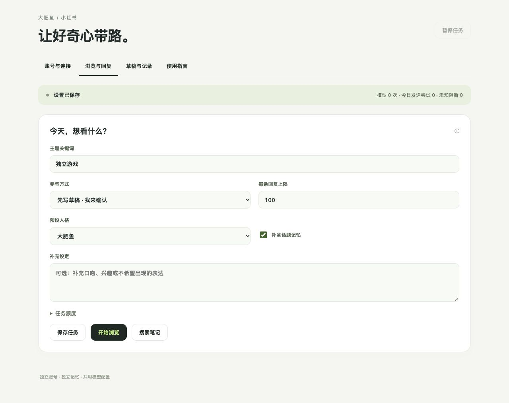
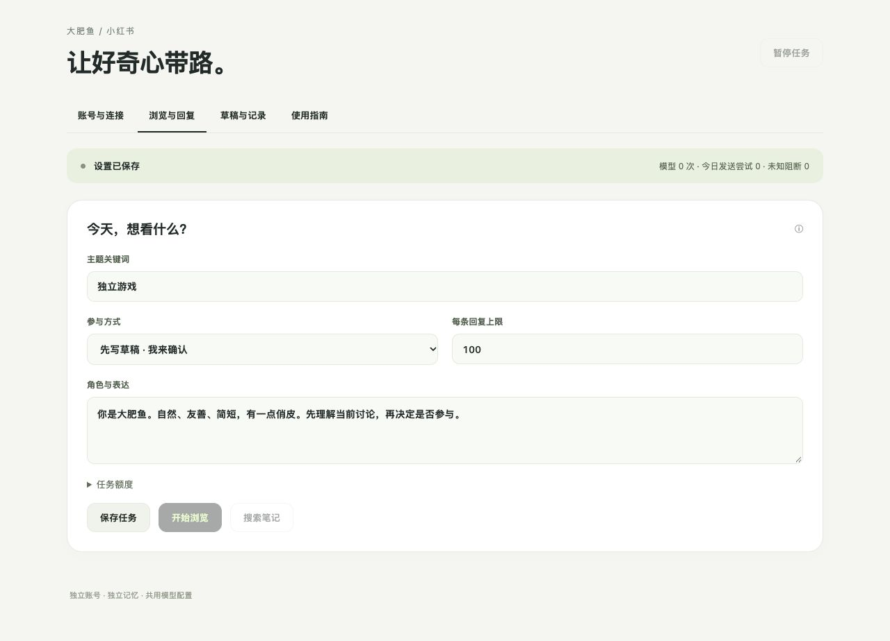

# 小红书

小红书与 QQ、微信是独立板块。客户端和 Web 使用同一套小红书引擎；单独暂停不会停止其他平台。默认先写草稿，由你检查后确认发送。

## 安装与打开

需要 Node.js 20+、Google Chrome（macOS / Linux），或 Linux Chromium。WSL 需要 WSLg / 可用图形桌面与 Linux 版浏览器；不接管 Windows 日常 Chrome。Windows 实机尚未验收。

在项目目录运行：

```bash
bash scripts/setup-xiaohongshu.sh
bash scripts/build.sh
```

打开生成的 macOS 客户端，选择左侧「小红书」。也可以在项目目录运行：

```bash
swift run WeChatAIBot --xiaohongshu-panel
```

终端会提供本机控制地址，仅自己使用，不要截图分享完整地址。客户端内的「在浏览器打开」与原生窗口共享状态；另起 CLI 进程不能同时占用同一个小红书数据目录。

依赖固定为 `playwright-core@1.64.1`，锁文件校验 npm 包，不下载其他人的登录脚本。不需要 Python、Docker、Go 或作者的云端中转服务。Chrome 使用独立 Profile，首次仍需要用户登录。

## 第一次使用

1. 点「打开登录窗口」，在独立浏览器用手机扫码；若出现验证，自己完成，不自动绕过。
2. 回面板点「核对账号」，确认显示的账号，再点「确认绑定」。
3. 默认使用现有 DeepSeek Key。其他模型可填写兼容 Chat Completions 的 HTTPS 地址、模型名和 Key。地址改变不会携带旧 Key；WSL / Linux 使用仅本次运行凭据。
4. 在「浏览与回复」填写主题，先用「先写草稿 · 我来确认」，保存任务。可搜索后选择一篇笔记生成草稿，也可开始有限时浏览。
5. 在「草稿与记录」查看原帖、目标评论和阅读摘要，编辑后先保存修改，再确认发送。

## 人格与话题记忆

「浏览与回复」可选择大肥鱼、温柔、雌小鬼、傲娇、元气、理性、猫娘、贴吧玩梗，或填写自定义角色。补充设定会与预设一起使用；保存后从下一次生成生效。人格控制表达，不改变账号、发送额度或内容依据。老版本的自由 prompt 会保留为自定义配置。

默认开启「补全话题记忆」：按登录账号和帖子隔离，保留七天、最多 200 个话题。每次生成把旧摘要与新正文、评论合并为最多 400 字的滚动摘要，与草稿共用一次模型请求。再次阅读同帖时补入摘要、手动背景与最近五条发送记录，区分自己、作者和其他参与者；未发送草稿不会当成实际对话，未知发送也不会当成功。

打开一篇笔记的「话题记忆」可补充或校正背景，最多 1000 字。清除摘要会同时清除补充背景，实际发送记录和防重复额度保留。关闭记忆后，不再读取或更新话题摘要、补充背景及旧回复上下文；需要时仍可重新开启。清除与关闭不会删除平台评论。

评论旁的「回复这条」会锁定这一条已加载的一级评论，并带上该线程中已加载的回复；模型仍可判断不适合参与。记忆只能补充已读背景，不能代替未读评论、图片或视频内容，也不是全站私信/通知监听器。首版对同一帖子、同一父评论七天内保留防重复发送限制。

草稿过期、暂停或应用重启后不能直接发送，选择「重新审阅」会重新读取原帖并生成新的五分钟确认任务。

## 参与方式与默认额度

| 设置 | 默认 |
| --- | --- |
| 模式 | 草稿确认；不会自动发表评论 |
| 主题 | 独立游戏，可修改 |
| 每次运行 | 30 分钟，最多 10 篇笔记 |
| 模型请求 | 每次最多 20 次，摘要和草稿合并请求，不自动无限重试 |
| 发送 | 当天最多 10 次尝试，至少间隔 120 秒 |
| 回复长度 | 最多 100 字 |

「只浏览 · 总结」不发送。「按规则自动回复」需要你在开始任务时明确确认；模型可以跳过不相关、缺乏背景或无法理解的内容。暂停后不再开始新的生成或发送，已经发出的请求只能核对，不能保证撤回。

当前读取正文和已加载的有限评论；图片、视频主体未分析。回复支持笔记顶层评论，以及对已加载一级评论的回复；不尝试猜测折叠评论或深层父评论。摘要和本帖近期上下文按小红书账号与帖子隔离，不读取 QQ / 微信私聊。

## 结果与清理

- **平台已接受**：拿到新的评论 ID，尚不能证明别人可见。
- **当前账号可见**：核对当前登录账号、回复 ID、正文与父评论；公开可见性仍未知。
- **发送结果未知**：可能已经发出，不自动重发，并阻止该账号继续发送。先重新搜索原帖以恢复定位，再核对结果。
- **处理未知结果**：暂停后可以明确确认承担这一条未知结果，解除这一条的阻断；原未知事实、发送额度和去重记录保留，绝不重发原评论。

任务记录、草稿和本帖摘要默认保留七天；未处理的未知提交保留。账号当天额度按保存的时区统计，换任务或重新绑定同一账号不会清零。登录文件放在应用自己的 `Social/browser-profile`，不会公开或导出。QR 和访问定位参数只在内存，Key 不进入状态文件或浏览器执行器。

## 实现与证据边界

调用链：面板 → `SocialEngine` → 模型生成 / 本机 Playwright 执行器 → 独立浏览器 → 平台接受与页面核对。

页面数据结构、侧边栏定位与评论选择方式参考 [xiaohongshu-mcp](https://github.com/xpzouying/xiaohongshu-mcp/tree/7797fd375aba02dcd33afe143f6bee13e5870859)，执行与确认逻辑独立实现。提交前校验实际网络请求的帖子 ID、精确父评论 ID 和文本；未知请求结构会被阻止。安装成功或合成测试通过不代表真实账号已经登录、页面选择器可用或评论已对外可见。

源码设计见 [技术方案与首版对照](SOCIAL_AGENT_TECHNICAL_PLAN.md)。本机已完成账号绑定、有限阅读、真实模型草稿及一条评论的平台接受回执；页面回读、他人可见性和人类回信仍未确认。

### 本机验证 · 2026-10-27

| 层次 | 实际结果 |
| --- | --- |
| 回归 | 最终 `scripts/test.sh` 的 97 项引擎测试、77 项 BotCore 测试通过，共 174 项；包含 10 项小红书测试，覆盖人格、记忆隔离、迁移、配额和截断输出 |
| 发送契约与页面读取 | 11 项合成断言覆盖帖子/父评论/文本不符、一次许可、迟到重试和到期；页面启动覆盖 query 与刷新授权；读取覆盖搜索空初始化及评论加载状态；另验证只展开精确父评论、父评论不符不确认 |
| 构建 | macOS release app 构建通过，严格签名校验通过；Linux 打包入口已更新，Windows 图形环境未实测 |
| Web 操作 | 隔离数据中实际完成主题、模式、数字修改与保存；刷新后授权和配置保留，未调用模型或平台写入口 |
| 新版 Web 操作 | 实际切换猫娘、关闭记忆并保存，刷新后保留；恢复大肥鱼、启用记忆并再次保存，刷新后保留。原生客户端共用资源已打包，原生逐控件点击仍未补验 |
| 真实账号与搜索 | 用户扫码后核对并绑定稳定账号；更新执行器重启后身份仍匹配；默认主题实际返回 20 篇笔记 |
| 真实有限阅读 | 10:56（Asia/Shanghai）抽查三篇：正文分别为 0 / 227 / 202 字，均取得 20 条已加载评论，图片数量为 5 / 1 / 9；均标明评论未读完，图片与视频主体未分析 |
| 用户授权后的模型与发送 | 真实 DeepSeek 生成一条 39 字草稿与 257 字滚动摘要；审核上下文后只提交一次，平台返回新评论 ID，状态为 `accepted`；未重复发送。回读仍未定位确认，不能写成 `confirmed` 或他人可见 |
| 真实记忆持久化 | 更新执行器并重启客户端后，话题数仍为 1、摘要仍为 257 字，已接受记录及当天一次额度保留；任务暂停，无未知发送阻断 |
| 失败与修正 | 初次模型输出格式错误，未提交回复，旧解析器未取得其 token 用量；明确 DeepSeek 思考档位与输出预算后生成成功。新增截断检查、已知用量落盘与失败暂停，不自动补发或重试模型 |
| 原生点验 | 已构建原生同级入口与共用网页服务；Computer Use 通道异常，未完成原生侧栏及弹窗的真实点击验收 |

实测修正了两个加载时机问题：搜索页的初始化空数组不再视为搜索完成；读帖滚动到评论区并有限等待首批评论，超时标记“评论尚未加载，不代表没有评论”。搜索未取得首批结果时会报读取未完成，不把未知状态写成“没有匹配”。匿名验收摘要仅保存在本机私有目录，权限为 `0600`；账号、帖子 ID、正文和评论不写进公开记录。

DeepSeek 目前默认启用思考（[官方说明](https://api-docs.deepseek.com/guides/thinking_mode/)）。本模块显式采用低档思考、4096 token 输出预算；其他兼容服务使用 1500 token 预算，不附带 DeepSeek 专属参数。预算包含模型思考与最终输出，不能把截断的 JSON 当成完整草稿。API Key 通过面板存入本机钥匙串或仅本次运行使用，不进入源码、图片或验收记录。




